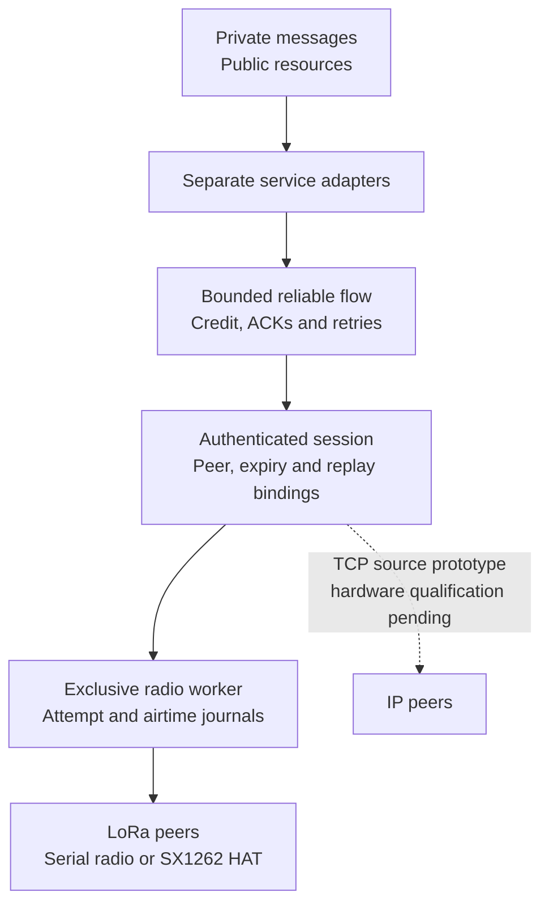

# Meshticulum


**Secure messages and verified resources across small radios and faster networks.**

A [SAGE Foundation](https://sage-foundation.net/) project, created and maintained by [Dhillon Andrew Kannabhiran (@l33tdawg)](https://github.com/l33tdawg). Part of the broader [SAGE project](https://github.com/l33tdawg/sage/).

**Project preview.** The public source and project website are live. `1.0.0-alpha` and its downloadable SDK/firmware assets have not been published. The alpha target is reliable verified delivery, deployable SDK and firmware, and sustained useful encrypted goodput above **1,000 B/s including sender startup**. [Project website](https://l33tdawg.github.io/meshticulum/) · [Documentation](docs/index.md) · [Current work and roadmap](docs/ROADMAP.md).

Meshticulum is an experimental transport and resource system for networks that mix LoRa and IP. We are building it to close the gap between practical embedded radio meshes and richer, secure networking across different transports—and to move more useful encrypted data through the radio time we have.

It began in SAGE Lantern and now lives as a standalone project. The transport, public-resource and offline envelope code work without SAGE or Lantern. [Lantern](https://github.com/l33tdawg/sage-lantern) consumes Meshticulum and owns its device and private SAGE integrations.

## SAGE project family

| Project | Repository and scope |
| --- | --- |
| **SAGE** | [Main SAGE repository](https://github.com/l33tdawg/sage/) — agent memory, governance and core infrastructure. |
| **Meshticulum** | [This repository](https://github.com/l33tdawg/meshticulum) — reusable transport, reliable flow, radio/IP carrier work and verified resource protocols. |
| **Lantern** | [SAGE Lantern repository](https://github.com/l33tdawg/sage-lantern) — product apps/UI, device provisioning, runtime orchestration and private SAGE integrations. |

The dependency goes one way: **Lantern → Meshticulum**. Meshticulum has no dependency on Lantern, the SAGE SDK, protected storage or fleet services. Lantern owns `software/meshticulum-integration/` and `firmware/meshticulum-bench/`; its private adapters and native deployment tools are outside this package. See [attribution and repository boundaries](docs/PROJECT_FAMILY.md).

Earlier extraction commits retain Lantern code as development history. The current tree and installable package are Meshticulum-only. [Repository history](docs/REPOSITORY_HISTORY.md) explains the separation and why that history is preserved.

## Why build this?

[MeshCore](https://github.com/meshcore-dev/MeshCore) brings lightweight multi-hop packet routing to embedded LoRa and other packet-radio devices. [Reticulum](https://reticulum.network/) provides a broader cryptographic networking stack for local and wide-area networks, including links with very little bandwidth. Both are valuable starting points for a network that must work away from reliable infrastructure.

Meshticulum combines those priorities in its own design: small, bounded radio transfers; explicit authenticated peers and services; and resources that can move across different paths while keeping their content identity. A private message should stay encrypted to its intended recipient as it crosses a relay. A public knowledge pack should be verifiable no matter which peer supplied its chunks. If IP becomes available, the network should use its measured advantage; if it disappears, verified work should survive the change of path.

This is a bridge between **design strengths**, with a separate Meshticulum protocol. Compatibility with existing MeshCore or Reticulum wire formats is not implemented. See [Why Meshticulum](docs/WHY.md) for the motivation and [the comparison](docs/COMPARISON.md) for the differences, tradeoffs and upstream references.

## Architecture at a glance



[Editable Mermaid](docs/diagrams/readme-1.mmd) · [Rendered SVG](docs/diagrams/readme-1.svg)

The diagram shows reusable source components. Finite native public campaigns have delivered a verified request/reply across LoRa and IP. A later campaign retained verified data through IP loss, resumed over freshly admitted LoRa and returned to a locally measured faster IP path. It verified four pieces totaling **3,908 bytes** within one original expiry. [The execution record](docs/IP_TRANSPORT.md#recorded-native-public-resume-and-ip-return) gives the exact source pins, timing and scope. Broader performance, private production and release qualification remain open.

Two service paths sit above the flow:

- **Private messages:** reusable recipient-encrypted, sender-signed envelopes. The compact binary carrier preserves the encrypted and signed bytes. Lantern supplies its protected admission, durable capture, consent policy and uncertain-write recovery outside Meshticulum.
- **Public resources:** signed manifests and content-addressed chunks. Bounded MR1 requests and replies move blocks over a scarce carrier; publisher and content verification determine which chunks enter the reusable cache.

The opt-in [experimental v2 forward-session primitive](docs/FORWARD_SECRECY.md) requires caller-owned, independently generated, dedicated Noise X25519 statics and pinned Ed25519 signing identities. The complete exchange and signed confirmations bind both key types and context before wrapping unchanged LM1/LM2 records. It rejects both pinned peers' known converted legacy recipient keys and MPF1 framing; retired v1 ID/role claims remain fenced in the retained counter namespace. Caller key-generation/purpose guarantees, protected lifecycle, full composition, native transport/key erasure and performance remain unqualified. There is no native/private service wiring or automatic legacy upgrade, and no deployed forward-secrecy or overall speed/security superiority claim.

Below them, admission binds each transfer to its peers, service, object and original expiry. Receiver credit bounds what can enter the flow. The scheduler and exclusive worker account for DATA, ACKs, retries and shared-medium costs. Local RF completion, peer receipt and application acceptance remain separate observations.

[Architecture](docs/ARCHITECTURE.md) follows a transfer through these boundaries and shows the intended mixed-path topology.

**Post-quantum status:** the default protocols use classical cryptography. A tested hybrid prototype in [draft PR #5](https://github.com/l33tdawg/meshticulum/pull/5) combines X25519 + ML-KEM-768 and requires both Ed25519 and ML-DSA-65 signatures. It is unmerged and has no device integration yet. This is future feasibility research, not an alpha dependency. [The status guide](docs/POST_QUANTUM.md) explains its design, radio overhead and how to try it.

## How we aim to make it faster

The goal is higher **useful encrypted goodput**: application bytes delivered under verification, rather than raw modem bitrate. In the retained radio bench, the timed interval ends at the sender's flow ACK; the receiver's durable hash is required separately. The design reduces avoidable carrier overhead through compact binary envelopes, bounded windows, selective acknowledgements and explicit receiver credit. Retry timing takes the carrier queue into account, and the request/reply adapters avoid carrying HTTP and base64 framing over the scarce radio link.

For public resources, the path policy uses local verified request timings and shared-bottleneck information. It can retain verified chunks and select among explicitly supplied routes; it does not equate an interface name with a fast path. The [authenticated TCP prototype](docs/IP_TRANSPORT.md) supports MR1 request/reply, and the later finite native campaign observed fresh-LoRa resume and return to a currently measured faster IP path. Its tiny service samples include management and final-ACK windows; they do not establish sustained carrier capacity or a speed ranking against MeshCore or Reticulum.

The uninterrupted public SDK samples completed **two fresh 100,000-byte files at 2,030.2 and 1,949.2 B/s including sender startup**, plus a **23,900-byte file at 2,534.6 B/s**. All used GFSK at 250 kb/s on a direct HAT-to-MCU link about one metre apart. The 100 kB files took **49.256 and 51.303 seconds through final authenticated receipt**, including all five parts and coordination gaps. Scope issue through endpoint closure took **53.879 and 56.957 seconds** (**1,856.0 and 1,755.7 B/s**). All ten receiver confirmations were accepted; the runs had zero and one DATA retransmissions, with zero new receiver drops. [Timing definitions, exact source and conditions](docs/RADIO_SDK_MEASUREMENTS.md) accompany this initial repeat. Broader completion and hardware coverage, sustained-capacity evidence and alpha release review remain open.

A separate [clean installed-wheel check](docs/RADIO_SDK_MEASUREMENTS.md#clean-installation-and-verified-piece-continuation) completed another fresh **100 kB file at 1,739.9 B/s including startup and a five-second pause between verified parts**. Normal isolated virtual environments matched all 67 runtime files to the candidate wheel, and all ten endpoint processes closed successfully. Final selected-artifact and release review remain pending.

Earlier LoRa results remain separate: a 30-sample bench recorded about **1.2 kB/s median**, and two later 16,356-byte public responses reached **1.037 and 1.071 kB/s** through reliable-flow ACK with zero DATA retries or duplicates. [Performance](docs/PERFORMANCE.md) retains those historical conditions and scoped upstream comparisons. The immediate target is sustained useful encrypted delivery above **1,000 B/s including startup**, with reliable completion and deployable code. **4–5 kB/s is an optional later stretch**, not an alpha release gate. The new GFSK samples and earlier LoRa results retain their own source pins and measurement boundaries.

[Performance](docs/PERFORMANCE.md) explains the available evidence, units, measurement boundaries and the scope of comparisons with published upstream figures.

## What works today?

| Area | Current evidence | Next qualification |
| --- | --- | --- |
| Reliable transport | MT05 flow composed with session authentication, bounded credit and queues, ACK/retry behavior, durable replay and attempt journals | Current hardware timing, completed radio transfers and settled worker debt |
| Radio adapters | Reusable exclusive serial-radio and Linux SX1262 workers; finite public service composition | Coordinated Lantern device runs with bounded disarm and rollback |
| Public resources | Direct GFSK samples reached 1.95–2.03 kB/s on two fresh 100 kB files; a clean installed-wheel file reached 1.74 kB/s including startup and a five-second verified-piece pause | Wider completion/recovery and mixed-path coverage, field range and final release review |
| Private messages | Offline encrypted envelopes and compact binary carrier | Lantern's real native ownership, protected backend, consent and recovery behavior |
| Standalone packaging | Canonical Python package and standalone source suite | Candidate artifact review and separately qualified Lantern deployment |

[CI](.github/workflows/tests.yml) runs the standalone suite and frozen-flow check on Python 3.11, 3.12 and 3.13. Historical [extraction validation](provenance/VALIDATION.json) remains a checkpoint for its original source snapshot. Private integration controls belong to Lantern and must be tied to its exact Meshticulum dependency. Source checks support implementation behavior. The recorded native public campaigns have their own exact execution pins; private native owner/consent and transport, sustained performance, firmware source/deployed-image equivalence and release gates remain open. The [roadmap](docs/ROADMAP.md) tracks that work.

## Install and explore

Python 3.11 or later is required. The offline core runs on a development host. Reusable radio drivers need the corresponding hardware interfaces; Lantern owns the native device entry points and their deployment requirements.

```sh
git clone https://github.com/l33tdawg/meshticulum.git
cd meshticulum
python -m venv .venv
. .venv/bin/activate
python -m pip install -e '.[dev]'
python -m pytest
python tools/verify_frozen_flow.py
```

Start with the canonical package imports:

```python
from meshticulum.contracts.identity import PeerID
from meshticulum.privacy.mesh_binary_envelope import to_binary, to_text
from meshticulum.resources.resource import BlockReader, BlockServer
```

`BlockReader` uses a caller-supplied, bounded exchange that must enforce authentication, admission and the absolute deadline. `BlockServer` reads from a caller-owned verified public-resource allowlist. The envelope conversion helpers change the carrier representation while preserving the sealed content; they do not create a transport session.

The generic public-resource CLI help is safe to inspect:

```sh
meshticulum-seed --help
```

For your own Linux radio hardware, the [signed five-part file example](examples/BUNDLE.md) consumes your application's approved finite grants and composes the existing MB1 service, crypto, durable journals and publisher verification. Start with [app-only flashing and rollback](docs/FLASHING.md) if you need to install a compatible firmware image. Source/model controls establish no physical completion or throughput result.

A Lantern device service run needs Lantern's separately provisioned finite grant and trusted exclusive worker. Follow [Hardware](docs/HARDWARE.md) for the boundary and [Lantern integration](docs/SAGE_INTEGRATION.md) for the owning repository. Meshticulum does not provide a product-pilot CLI or a SAGE installation extra. Source tests use synthetic identities and explicit source models; they do not flash radios or start production services.

## Repository map

| Location | Responsibility |
| --- | --- |
| `src/meshticulum/contracts` | Peer, service, session, route, limit and deadline contracts |
| `src/meshticulum/scheduler` | Admission, attempt settlement and medium budgeting |
| `src/meshticulum/flow` | Accepted bounded reliable-flow and finite-port candidate |
| `src/meshticulum/bench` | Authenticated frames, journals, reusable workers and public service composition |
| `src/meshticulum/ip` | Authenticated TCP prototype, bounded stream budgets and replay state |
| `src/meshticulum/resources` | Signed public packs, block exchange, verified cache and path policy |
| `src/meshticulum/privacy` | Offline recipient-encrypted envelopes and binary carrier |
| `tests` | Standalone protocol, resource, carrier and failure controls |
| `tools` | Frozen-flow, documentation, artifact and retained-benchmark checks |

New code should use `meshticulum.*` imports. Small compatibility bridges preserve the module and class identity of the unchanged accepted flow. [Extraction and provenance](docs/EXTRACTION.md) records the original source, namespace changes and frozen hashes.

## Read more and contribute

[Documentation home](docs/index.md) · [Why](docs/WHY.md) · [Architecture](docs/ARCHITECTURE.md) · [MeshCore/Reticulum comparison](docs/COMPARISON.md) · [Performance](docs/PERFORMANCE.md) · [Experimental forward sessions](docs/FORWARD_SECRECY.md) · [Roadmap](docs/ROADMAP.md) · [1.0.0-alpha readiness](docs/RELEASE_READINESS.md)

Before changing transport behavior, read [AGENTS.md](AGENTS.md), run the standalone suite and verify the frozen-flow pins. Changes to the accepted flow and port require a reviewed revision. Keep original deadlines, replay decisions and attempt debt intact across cancellation and restart, and preserve failed or unavailable measurements alongside successful runs.

Meshticulum is licensed under [Apache-2.0](LICENSE), with inherited attribution in [NOTICE](NOTICE). MeshCore-derived board support and other third-party components retain their own licenses; the standalone firmware recipe and license inventory are still being completed.
