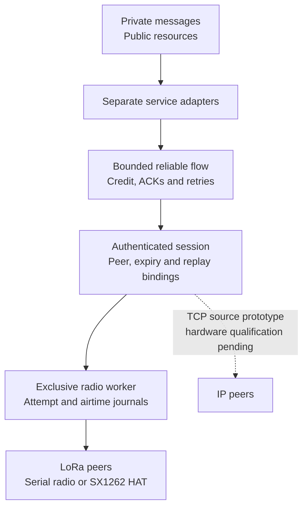

# Meshticulum

**Secure messages and verified resources across small radios and faster networks.**

A [SAGE Foundation](https://sage-foundation.net/) project, created and maintained by [Dhillon Andrew Kannabhiran (@l33tdawg)](https://github.com/l33tdawg). Part of the broader [SAGE project](https://github.com/l33tdawg/sage/).

Meshticulum is an experimental transport and resource system for networks that mix LoRa and IP. We are building it to close the gap between practical embedded radio meshes and richer, secure networking across different transports—and to move more useful encrypted data through the radio time we have.

It began in SAGE Lantern and now lives as a standalone project. The transport, public-resource and offline envelope code work without SAGE or Lantern. [Lantern](https://github.com/l33tdawg/sage-lantern) consumes Meshticulum and owns its device and private SAGE integrations.

## SAGE project family

| Project | Repository and scope |
| --- | --- |
| **SAGE** | [Main SAGE repository](https://github.com/l33tdawg/sage/) — agent memory, governance and core infrastructure. |
| **Meshticulum** | [This repository](https://github.com/l33tdawg/meshticulum) — reusable transport, reliable flow, radio/IP carrier work and verified resource protocols. |
| **Lantern** | [SAGE Lantern repository](https://github.com/l33tdawg/sage-lantern) — product apps/UI, device provisioning, runtime orchestration and private SAGE integrations. |

The dependency goes one way: **Lantern → Meshticulum**. Meshticulum has no dependency on Lantern, the SAGE SDK, protected storage or fleet services. Lantern owns `software/meshticulum-integration/` and `firmware/meshticulum-bench/`; its private adapters and native deployment tools are outside this package. See [attribution and repository boundaries](docs/PROJECT_FAMILY.md).

## Why build this?

[MeshCore](https://github.com/meshcore-dev/MeshCore) brings lightweight multi-hop packet routing to embedded LoRa and other packet-radio devices. [Reticulum](https://reticulum.network/) provides a broader cryptographic networking stack for local and wide-area networks, including links with very little bandwidth. Both are valuable starting points for a network that must work away from reliable infrastructure.

Meshticulum combines those priorities in its own design: small, bounded radio transfers; explicit authenticated peers and services; and resources that can move across different paths while keeping their content identity. A private message should stay encrypted to its intended recipient as it crosses a relay. A public knowledge pack should be verifiable no matter which peer supplied its chunks. If IP becomes available, the network should use its measured advantage; if it disappears, verified work should survive the change of path.

This is a bridge between **design strengths**, with a separate Meshticulum protocol. Compatibility with existing MeshCore or Reticulum wire formats is not implemented. See [Why Meshticulum](docs/WHY.md) for the motivation and [the comparison](docs/COMPARISON.md) for the differences, tradeoffs and upstream references.

## Architecture at a glance



[Editable Mermaid](docs/diagrams/readme-1.mmd) · [Rendered SVG](docs/diagrams/readme-1.svg)

The diagram shows reusable source components. Lantern has recorded finite native public mixed-path and loss/resume/IP-return campaigns; broader performance, private production and release qualification remain open. The dotted TCP branch marks an experimental carrier, not an unexecuted path.

At historical pins core `6605ba714ce414445673b40bfcfe93fe467b86aa`, Lantern [a41851a](https://github.com/l33tdawg/sage-lantern/commit/a41851a4301008bd840a8508187a59a150eeaa0e) and runtime `d3194a9`, a finite public C→A LoRa→B IP request and reverse reply completed with **977 independently verified public bytes**. The [native milestone record](docs/IP_TRANSPORT.md#recorded-native-public-milestone) gives the full pins and scope. A separate fresh failure/resume campaign observed TCP loss after **512 stream bytes** and preserved its first verified piece, but refused fresh LoRa before ARM/TX: the fixed 90-second lease exceeded approximately 85 seconds remaining. That earlier attempt did not complete resume.

A later fresh **160-second campaign**, at core `a89c1ca6fdf1865d61367cf3a8d59ac1ab50cb39`, Lantern runtime code [379025e](https://github.com/l33tdawg/sage-lantern/commit/379025e177619ee3ffd51ef8d5ae0b2bc27dd54e) and runtime `856570c`, completed IP loss, fresh C↔B LoRa request/reply and measured IP return. It independently verified **four 977-byte pieces / 3,908 useful bytes**, preserved the first piece through an injected **512-stream-byte loss**, and rejected the partial reply. All verification stayed within the original expiry. Ten sessions produced twenty terminal, retired native children; three owned management masters were terminal. The read-only journal/holder/service audit passed and handback completed before **11:35 UTC on 2026-10-10**. [Full pins and scope](docs/IP_TRANSPORT.md#recorded-native-public-resume-and-ip-return) · [Lantern evidence](https://github.com/l33tdawg/sage-lantern/blob/2f96d9029f972e665286209d9883418d431ab1d0/docs/lantern/evidence/meshticulum-native-resume-20261010.json).

Two service paths sit above the flow:

- **Private messages:** reusable recipient-encrypted, sender-signed envelopes. The compact binary carrier preserves the encrypted and signed bytes. Lantern supplies its protected admission, durable capture, consent policy and uncertain-write recovery outside Meshticulum.
- **Public resources:** signed manifests and content-addressed chunks. Bounded MR1 requests and replies move blocks over a scarce carrier; publisher and content verification determine which chunks enter the reusable cache.

The opt-in [experimental v2 forward-session primitive](docs/FORWARD_SECRECY.md) requires caller-owned, independently generated, dedicated Noise X25519 statics and pinned Ed25519 signing identities. The complete exchange and signed confirmations bind both key types and context before wrapping unchanged LM1/LM2 records. It rejects both pinned peers' known converted legacy recipient keys and MPF1 framing; retired v1 ID/role claims remain fenced in the retained counter namespace. Caller key-generation/purpose guarantees, protected lifecycle, full composition, native transport/key erasure and performance remain unqualified. There is no native/private service wiring or automatic legacy upgrade, and no deployed forward-secrecy or overall speed/security superiority claim.

Below them, admission binds each transfer to its peers, service, object and original expiry. Receiver credit bounds what can enter the flow. The scheduler and exclusive worker account for DATA, ACKs, retries and shared-medium costs. Local RF completion, peer receipt and application acceptance remain separate observations.

[Architecture](docs/ARCHITECTURE.md) follows a transfer through these boundaries and shows the intended mixed-path topology.

## How we aim to make it faster

The goal is higher **useful encrypted goodput**: application bytes delivered under verification, rather than raw modem bitrate. In the retained radio bench, the timed interval ends at the sender's flow ACK; the receiver's durable hash is required separately. The design reduces avoidable carrier overhead through compact binary envelopes, bounded windows, selective acknowledgements and explicit receiver credit. Retry timing takes the carrier queue into account, and the request/reply adapters avoid carrying HTTP and base64 framing over the scarce radio link.

For public resources, the path policy uses local verified request timings and shared-bottleneck information. It can retain verified chunks and select among explicitly supplied routes; it does not equate an interface name with a fast path. The [authenticated TCP prototype](docs/IP_TRANSPORT.md) supports MR1 request/reply, and the later finite native campaign observed fresh-LoRa resume and return to a currently measured faster IP path. Its tiny service samples include management and final-ACK windows; they do not establish sustained carrier capacity or a speed ranking against MeshCore or Reticulum.

Retained single-radio bench runs from 2026-10-09 recorded about **1.2 kB/s median useful encrypted goodput** across C→A, C→B and A→B LoRa links, with 30 completed RF samples. That is evidence from an earlier experimental runtime. Five later native public resource samples recorded **782, 708, 975 and 996.7 B/s** for 16,356 useful bytes, and **936.7 B/s with zero retries** for an 8,164-byte piece. The latest 16,356-byte response completed with **zero DATA retries**; its 996.7 B/s result remains below the 1,000 B/s minimum target. These rates end at the sender's reliable-flow ACK; publisher/content verification is separately required. [Current native samples and exact pins](docs/PERFORMANCE.md#native-public-resource-transfers-2026-10-11) remain distinct from the older distribution. Sustained capacity and native private forward-secrecy qualification remain open. The programme target is **1–1.5 kB/s**; comparison with published MeshCore/Reticulum figures is recorded with its conditions and limits in [Performance](docs/PERFORMANCE.md#comparison-with-published-figures).

[Performance](docs/PERFORMANCE.md) explains the available evidence, units, measurement boundaries and the scope of comparisons with published upstream figures.

## What works today?

| Area | Current evidence | Next qualification |
| --- | --- | --- |
| Reliable transport | MT05 flow composed with session authentication, bounded credit and queues, ACK/retry behavior, durable replay and attempt journals | Current hardware timing, completed radio transfers and settled worker debt |
| Radio adapters | Reusable exclusive serial-radio and Linux SX1262 workers; finite public service composition | Coordinated Lantern device runs with bounded disarm and rollback |
| Public resources | Finite native mixed request/reply verified 977 bytes; a later loss/LoRa-resume/IP-return campaign verified four pieces / 3,908 bytes under one original expiry | Broader Meshticulum performance qualification, published-comparison review and release review |
| Private messages | Offline encrypted envelopes and compact binary carrier | Lantern's real native ownership, protected backend, consent and recovery behavior |
| Standalone packaging | Canonical Python package and standalone source suite | Candidate artifact review and separately qualified Lantern deployment |

[CI](.github/workflows/tests.yml) runs the standalone suite and frozen-flow check on Python 3.11, 3.12 and 3.13. Historical [extraction validation](provenance/VALIDATION.json) remains a checkpoint for its original source snapshot. Private integration controls belong to Lantern and must be tied to its exact Meshticulum dependency. Source checks support implementation behavior. The recorded native public campaigns have their own exact execution pins; private native owner/consent and transport, sustained performance, firmware source/deployed-image equivalence and release gates remain open. The [roadmap](docs/ROADMAP.md) tracks that work.

## Install and explore

Python 3.11 or later is required. The offline core runs on a development host. Reusable radio drivers need the corresponding hardware interfaces; Lantern owns the native device entry points and their deployment requirements.

```sh
git clone https://github.com/l33tdawg/meshticulum.git
cd meshticulum
python -m venv .venv
. .venv/bin/activate
python -m pip install -e '.[dev]'
python -m pytest
python tools/verify_frozen_flow.py
```

Start with the canonical package imports:

```python
from meshticulum.contracts.identity import PeerID
from meshticulum.privacy.mesh_binary_envelope import to_binary, to_text
from meshticulum.resources.resource import BlockReader, BlockServer
```

`BlockReader` uses a caller-supplied, bounded exchange that must enforce authentication, admission and the absolute deadline. `BlockServer` reads from a caller-owned verified public-resource allowlist. The envelope conversion helpers change the carrier representation while preserving the sealed content; they do not create a transport session.

The generic public-resource CLI help is safe to inspect:

```sh
meshticulum-seed --help
```

A device service run needs Lantern's separately provisioned finite grant and trusted exclusive worker. Follow [Hardware](docs/HARDWARE.md) for the boundary and [Lantern integration](docs/SAGE_INTEGRATION.md) for the owning repository. Meshticulum does not provide a product-pilot CLI or a SAGE installation extra. Source tests use synthetic identities and explicit source models; they do not flash radios or start production services.

## Repository map

| Location | Responsibility |
| --- | --- |
| `src/meshticulum/contracts` | Peer, service, session, route, limit and deadline contracts |
| `src/meshticulum/scheduler` | Admission, attempt settlement and medium budgeting |
| `src/meshticulum/flow` | Accepted bounded reliable-flow and finite-port candidate |
| `src/meshticulum/bench` | Authenticated frames, journals, reusable workers and public service composition |
| `src/meshticulum/ip` | Authenticated TCP prototype, bounded stream budgets and replay state |
| `src/meshticulum/resources` | Signed public packs, block exchange, verified cache and path policy |
| `src/meshticulum/privacy` | Offline recipient-encrypted envelopes and binary carrier |
| `tests` | Standalone protocol, resource, carrier and failure controls |
| `tools` | Frozen-flow, documentation, artifact and retained-benchmark checks |

New code should use `meshticulum.*` imports. Small compatibility bridges preserve the module and class identity of the unchanged accepted flow. [Extraction and provenance](docs/EXTRACTION.md) records the original source, namespace changes and frozen hashes.

## Read more and contribute

[Documentation home](docs/index.md) · [Why](docs/WHY.md) · [Architecture](docs/ARCHITECTURE.md) · [MeshCore/Reticulum comparison](docs/COMPARISON.md) · [Performance](docs/PERFORMANCE.md) · [Experimental forward sessions](docs/FORWARD_SECRECY.md) · [Roadmap](docs/ROADMAP.md) · [1.0.0-alpha readiness](docs/RELEASE_READINESS.md)

Before changing transport behavior, read [AGENTS.md](AGENTS.md), run the standalone suite and verify the frozen-flow pins. Changes to the accepted flow and port require a reviewed revision. Keep original deadlines, replay decisions and attempt debt intact across cancellation and restart, and preserve failed or unavailable measurements alongside successful runs.

Meshticulum is licensed under [Apache-2.0](LICENSE), with inherited attribution in [NOTICE](NOTICE). MeshCore-derived board support and other third-party components retain their own licenses; the standalone firmware recipe and license inventory are still being completed.
