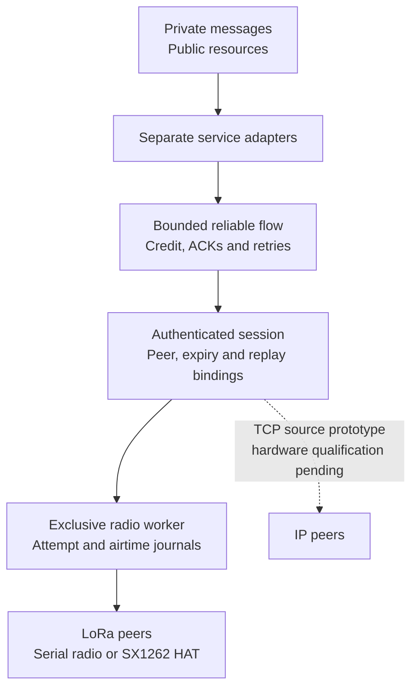

# Meshticulum


**Secure messages and verified resources across small radios and faster networks.**

A [SAGE Foundation](https://sage-foundation.net/) project, created and maintained by [Dhillon Andrew Kannabhiran (@l33tdawg)](https://github.com/l33tdawg). Part of the broader [SAGE project](https://github.com/l33tdawg/sage/).

**Experimental `1.0.0-alpha.4`.** The [GitHub prerelease](https://github.com/l33tdawg/meshticulum/releases/tag/v1.0.0-alpha.4) provides the `1.0.0a4` SDK wheel, normalized source archive, firmware source-build guide, notices and validation records. See [release status](docs/RELEASE_READINESS.md) for the exact artifacts and hardware evidence. The alpha scope is reliable verified delivery, a deployable SDK and firmware build path, and useful encrypted goodput above **3 kB/s (24 kbit/s)** including sender startup on the declared tested path. [Project website](https://l33tdawg.github.io/meshticulum/) · [Documentation](docs/index.md) · [Current work and roadmap](docs/ROADMAP.md).

Alpha.4 repairs a saturated train12 recovery stall. A fully occupied logical
window with no physical DATA outstanding can now use one fresh authenticated
later SACK through the existing bounded selective-repair train. The path still
requires live authority, exact physical drain, a saturated peer window and no
due ordinary retry timer; ordinary flows retain their three-SACK threshold.
Three exact-wheel near-bench SF5 files completed at **3,149.246–3,192.081 B/s**
including sender startup, each with one DATA retransmission and full publisher,
part and whole-file verification. The [repeat record](benchmarks/2026-10-30-sf5-alpha4-repeat-profile/README.md)
keeps the timing boundary, endpoint closures and finite-sample limits explicit.

Alpha.3 keeps journal accounting reads independent of retained-history length,
adds opt-in [host phase timings](docs/HOST_PROFILING.md), and rechecks the serial
write deadline after writable readiness. Durable reservations, charged debt and
the MCU's receive/listening guards remain in force. The [local journal profile](benchmarks/2026-10-30-host-journal/README.md)
shows the host scaling change; it is not a measurement of radio throughput.

Alpha.2 introduced the opt-in **host-backed MCU DATA queue**. In one
24 October LoRa comparison, startup-inclusive useful goodput rose from
**931.3 to 1,084.8 B/s (+16.48%)** for two fresh 8,164-byte files over the same
approximately 20 m link. Both verified with zero retries, drops or new UNKNOWN
outcomes. Linux still owns keys, authenticated ACKs, credit and retries.
[Measured scope and retained failures](benchmarks/2026-10-24-mcu-queue-lora/README.md)
accompany this single fixed-order pair. The measured source and wheel are
separate from the published alpha.2 artifacts: their runtime correspondence was
checked, but the rebuilt wheel has no fresh RF execution. The original alpha.1
release remains unchanged.

Meshticulum is an experimental transport and resource system for networks that mix LoRa and IP. We are building it to close the gap between practical embedded radio meshes and richer, secure networking across different transports—and to move more useful encrypted data through the radio time we have.

It began in SAGE Lantern and now lives as a standalone project. The transport, public-resource and offline envelope code work without SAGE or Lantern. [Lantern](https://github.com/l33tdawg/sage-lantern) consumes Meshticulum and owns its device and private SAGE integrations.

## Start here

Meshticulum is an experimental alpha. You can make a useful contribution
without owning a radio or making an RF decision.

| What you want to do | Start with | Useful result |
| --- | --- | --- |
| Try the SDK offline (**Level 0**) | [Testers' Guide](docs/TESTER_GUIDE.md#1-try-it-on-your-computer) | The signed-resource demo and its `Verified public chunk: 287 bytes` result |
| Reproduce the firmware build (**Level 1**) | [Firmware recipe](docs/FIRMWARE_RECIPE.md) | `SOURCE.json`, `BUILD.json` and target output hashes |
| Install on a spare matching board (**Level 2**) | [Device setup](docs/DEVICE_SETUP.md) | Exact board/image identity, inspection and recovery result |
| Check app-only update and rollback (**Level 3**) | [Flashing and rollback](docs/FLASHING.md) | Current/backup correspondence and the completed rollback check |
| Run a near-bench radio transfer (**Level 4**) | [Signed-file walkthrough](examples/BUNDLE.md) | Authenticated receipts plus publisher and whole-file verification |

The public [community tester campaign](https://github.com/l33tdawg/meshticulum/issues/43)
tracks the ladder and claim boundaries. Open a separate
[tester report](https://github.com/l33tdawg/meshticulum/issues/new?template=tester-report.yml)
for each result or failure. Level 5 field, mixed-path and loss/resume work is
project-operated and is not part of the initial community campaign.

## SAGE project family

| Project | Repository and scope |
| --- | --- |
| **SAGE** | [Main SAGE repository](https://github.com/l33tdawg/sage/) — agent memory, governance and core infrastructure. |
| **Meshticulum** | [This repository](https://github.com/l33tdawg/meshticulum) — reusable transport, reliable flow, radio/IP carrier work and verified resource protocols. |
| **Lantern** | [SAGE Lantern repository](https://github.com/l33tdawg/sage-lantern) — product apps/UI, device provisioning, runtime orchestration and private SAGE integrations. |

The dependency goes one way: **Lantern → Meshticulum**. Meshticulum has no dependency on Lantern, the SAGE SDK, protected storage or fleet services. Lantern owns `software/meshticulum-integration/` and `firmware/meshticulum-bench/`; its private adapters and native deployment tools are outside this package. See [attribution and repository boundaries](docs/PROJECT_FAMILY.md).

Earlier extraction commits retain Lantern code as development history. The current tree and installable package are Meshticulum-only. [Repository history](docs/REPOSITORY_HISTORY.md) explains the separation and why that history is preserved.

## Why build this?

[MeshCore](https://github.com/meshcore-dev/MeshCore) brings lightweight multi-hop packet routing to embedded LoRa and other packet-radio devices. [Reticulum](https://reticulum.network/) provides a broader cryptographic networking stack for local and wide-area networks, including links with very little bandwidth. Both are valuable starting points for a network that must work away from reliable infrastructure.

Meshticulum combines those priorities in its own design: small, bounded radio transfers; explicit authenticated peers and services; and resources that can move across different paths while keeping their content identity. A private message should stay encrypted to its intended recipient as it crosses a relay. A public knowledge pack should be verifiable no matter which peer supplied its chunks. If IP becomes available, the network should use its measured advantage; if it disappears, verified work should survive the change of path.

This is a bridge between **design strengths**, with a separate Meshticulum protocol. Compatibility with existing MeshCore or Reticulum wire formats is not implemented. See [Why Meshticulum](docs/WHY.md) for the motivation and [the comparison](docs/COMPARISON.md) for the differences, tradeoffs and upstream references.

## Architecture at a glance



[Editable Mermaid](docs/diagrams/readme-1.mmd) · [Rendered SVG](docs/diagrams/readme-1.svg)

The diagram shows reusable source components. Finite native public campaigns have delivered a verified request/reply across LoRa and IP. A later campaign retained verified data through IP loss, resumed over freshly admitted LoRa and returned to a locally measured faster IP path. It verified four pieces totaling **3,908 bytes** within one original expiry. [The execution record](docs/IP_TRANSPORT.md#recorded-native-public-resume-and-ip-return) gives the exact source pins, timing and scope. Broader performance, private production and release qualification remain open.

Two service paths sit above the flow:

- **Private messages:** reusable recipient-encrypted, sender-signed envelopes. The compact binary carrier preserves the encrypted and signed bytes. Lantern supplies its protected admission, durable capture, consent policy and uncertain-write recovery outside Meshticulum.
- **Public resources:** signed manifests and content-addressed chunks. Bounded MR1 requests and replies move blocks over a scarce carrier; publisher and content verification determine which chunks enter the reusable cache.

The opt-in [experimental v2 forward-session primitive](docs/FORWARD_SECRECY.md) requires caller-owned, independently generated, dedicated Noise X25519 statics and pinned Ed25519 signing identities. The complete exchange and signed confirmations bind both key types and context before wrapping unchanged LM1/LM2 records. It rejects both pinned peers' known converted legacy recipient keys and MPF1 framing; retired v1 ID/role claims remain fenced in the retained counter namespace. Caller key-generation/purpose guarantees, protected lifecycle, full composition, native transport/key erasure and performance remain unqualified. There is no native/private service wiring or automatic legacy upgrade, and no deployed forward-secrecy or overall speed/security superiority claim.

Below them, admission binds each transfer to its peers, service, object and original expiry. Receiver credit bounds what can enter the flow. The scheduler and exclusive worker account for DATA, ACKs, retries and shared-medium costs. Local RF completion, peer receipt and application acceptance remain separate observations.

Current protocols use classical cryptography. An opt-in, test-only [post-quantum source prototype](docs/POST_QUANTUM_PROTOTYPE.md) combines X25519 and ML-KEM-768 through X-Wing draft 11, with both Ed25519 and ML-DSA-65 signatures required. It includes a runnable exchange and measured packet sizes, but it is not an alpha dependency. Radio integration, native key lifecycle and independent cryptographic review remain open; [the status guide](docs/POST_QUANTUM.md) covers the boundaries.

[Architecture](docs/ARCHITECTURE.md) follows a transfer through these boundaries and shows the intended mixed-path topology.

## How we aim to make it faster

The goal is higher **useful encrypted goodput**: application bytes delivered under verification, rather than raw modem bitrate. In the retained radio bench, the timed interval ends at the sender's flow ACK; the receiver's durable hash is required separately. The design reduces avoidable carrier overhead through compact binary envelopes, bounded windows, selective acknowledgements and explicit receiver credit. Retry timing takes the carrier queue into account, and the request/reply adapters avoid carrying HTTP and base64 framing over the scarce radio link.

For public resources, the path policy uses local verified request timings and shared-bottleneck information. It can retain verified chunks and select among explicitly supplied routes; it does not equate an interface name with a fast path. The [authenticated TCP prototype](docs/IP_TRANSPORT.md) supports MR1 request/reply, and the later finite native campaign observed fresh-LoRa resume and return to a currently measured faster IP path. Its tiny service samples include management and final-ACK windows; they do not establish sustained carrier capacity or a speed ranking against MeshCore or Reticulum.

The uninterrupted public SDK samples completed **two fresh 100,000-byte files at 2.03 and 1.95 kB/s (16.24 and 15.59 kbit/s) of useful application throughput including sender startup**, plus a **23,900-byte file at 2.53 kB/s (20.28 kbit/s)**. All used GFSK at 250 kbit/s on a direct HAT-to-MCU link about one metre apart. The 100 kB files took **49.256 and 51.303 seconds through final authenticated receipt**, including all five parts and coordination gaps. Scope issue through endpoint closure took **53.879 and 56.957 seconds** (**1.86 and 1.76 kB/s; 14.85 and 14.05 kbit/s**). All ten receiver confirmations were accepted; the runs had zero and one DATA retransmissions, with zero new receiver drops. [Timing definitions, exact source and conditions](docs/RADIO_SDK_MEASUREMENTS.md) accompany this initial repeat. Broader completion, hardware coverage and sustained-capacity evidence remain open.

The same public signed-bundle path also completed fresh **250 kB, 500 kB and 1 MB files at 2.111, 2.216 and 2.230 kB/s (16.889, 17.725 and 17.838 kbit/s) including sender startup**. All receivers verified every signed part and the complete file. Scope issue through both endpoints closed took **121.214, 228.292 and 450.903 seconds** (**2.063, 2.190 and 2.218 kB/s; 16.500, 17.521 and 17.742 kbit/s**). These 11-, 21- and 42-part runs used source `1f85608`; [the measurement report](docs/RADIO_SDK_MEASUREMENTS.md#larger-public-files) records retries, receive drops and exact windows.

Alpha.4 then completed three fresh **23,900-byte B-to-A SF5/BW500 files at
3,149.246, 3,188.156 and 3,192.081 B/s (25.194, 25.505 and 25.537 kbit/s)
including sender startup**. All three exact-wheel runs used the repaired
train12 policy, accepted 12 authenticated sender ACKs, verified the complete
file and had one DATA retransmission with zero duplicate flow events. The
[repeat qualification](benchmarks/2026-10-30-sf5-alpha4-repeat-profile/README.md)
retains the exact timing boundary and limits this claim to three finite
near-bench samples.

All three final samples clear the owner's **2.0 kB/s whole-file floor**. An
earlier fresh 1 MB run reached 1.750 kB/s while the sender host's production LLM
engine occupied its pinned CPU4; that result remains in the record. The
CPU-isolated control fell to **8.66 seconds per part** and raised the whole-file
rate to **2.230 kB/s**, establishing the declared near-bench result.

Two complete matched LoRa campaigns then produced **six same-payload pairs** at
SF7/BW500 and SF8/BW500. Median sender-ARM-to-receipt rates were **1.103 and
0.720 kB/s (8.820 and 5.759 kbit/s)**, making SF8 **1.531×** slower on this
near-bench link. All 12 chunks and authenticated receipts verified. The MCU's
**1,024-attempt** cumulative cap stood at 380 after both campaigns, leaving
**644 attempts of headroom**, on one boot generation with zero receive drops.
[The profile record](benchmarks/2026-10-18-lora-sf7-sf8/results.json) retains
the final and control medians and the exact debt accounting.

The HTTP gateway now meets a normal **30-second** browser timeout. Three
consecutive `links` requests through a radio-only endpoint and a second unit's
internet connection rendered in **17.77–17.99 seconds** wall time, with gateway
completion at **16.81–17.08 seconds**. The pre-fix startup race is retained as
the 52.8-second control. [The HTTP record](docs/HTTP_GATEWAY.md) explains the
3-second startup gap, exact receipts and opt-in routing direction.

An interactive `links` session also submitted a real Wiby search and opened a
small result page in about 20 seconds. Google browsing remains outside the
plain-HTTP gateway: `google.com` redirects to HTTPS and its search page is about
92 KB, above the 16 KiB response cap.

A separate [clean installed-wheel check](docs/RADIO_SDK_MEASUREMENTS.md#clean-installation-and-verified-piece-continuation) completed another fresh **100 kB file at 1.74 kB/s (13.92 kbit/s) including startup and a five-second pause between verified parts**. Normal isolated virtual environments matched all 67 runtime files to the published wheel, and all ten endpoint processes closed successfully. Wider recovery, hardware and sustained-capacity qualification remain open.

On 22 October, a fresh installed-wheel A/B run crossed approximately **20 metres
between two rooms**: a Heltec V4 sender delivered the same five-part
100,000-byte signed file to a Heltec V4 receiver at **1.776 kB/s including
sender startup**, with all five authenticated receipts and the complete file
verified. Receiver DATA RSSI was **-57.5 to -56.5 dBm** and both MCU receive-drop
deltas were zero. This is one operator-reported cross-room sample, not a field
range or sustained-capacity result. [The A/B record](benchmarks/2026-10-22-ab-cross-room/README.md)
retains the failed authentication attempt, exact evidence hashes and the
B-firmware rollback boundary.

The later 24 October MCU-queue pair used two Heltec V4 USB radios at
SF7/BW500/CR4:5, sync `0x42`, 921.375 MHz and 0 dBm. Baseline sender startup to
authenticated receipt took **8.766668 s**; queue mode took **7.526076 s**.
From the first DATA worker call or queued submission, the intervals were
**8.013809 and 6.900232 s**. Queue mode separately settled and released all
46 DATA physical results; drained endpoint completion followed authenticated
receipt by **27.456 ms**. The MCU driver time stayed about 4.99 s in both
modes, consistent with overlapped host/MCU work on the same radio profile. [The acceleration guide](docs/MCU_ACCELERATION.md)
explains the bounded policy and remaining repetition, loss and recovery work.

Earlier LoRa results remain separate: a 30-sample bench recorded about **1.2 kB/s median (9.6 kbit/s)**, and two later 16,356-byte public responses reached **1.037 and 1.071 kB/s** through reliable-flow ACK with zero DATA retries or duplicates. [Performance](docs/PERFORMANCE.md) retains those historical conditions and scoped upstream comparisons. Alpha 4 met the repeated near-bench SF5 target above **3 kB/s (24 kbit/s) including startup** for three finite files with reliable completion. Sustained larger-file delivery remains open; **4 to 5 kB/s (32 to 40 kbit/s) is an optional later stretch**, not an alpha release gate. Every GFSK, SF5 and earlier LoRa result retains its own source pins and measurement boundaries.

[Performance](docs/PERFORMANCE.md) explains the available evidence, units, measurement boundaries and the scope of comparisons with published upstream figures.

## What works today?

| Area | Current evidence | Next qualification |
| --- | --- | --- |
| Reliable transport | MT05 flow composed with session authentication, bounded credit and queues, ACK/retry behavior, durable replay and attempt journals | Current hardware timing, completed radio transfers and settled worker debt |
| Radio adapters | Reusable exclusive serial-radio and Linux SX1262 workers; finite public service composition | Coordinated Lantern device runs with bounded disarm and rollback |
| MCU DATA queue | Opt-in bounded ciphertext queue; one same-firmware LoRa pair improved startup-inclusive goodput by 16.48%, with every physical result settled | Repeated and reversed-order comparisons, loss/disconnect recovery, wider hardware and energy measurements |
| Public resources | Three Alpha 4 SF5 files reached 3,149–3,192 B/s with independent whole-file verification; two earlier 100 kB files reached 1.95–2.03 kB/s and 250 kB, 500 kB and 1 MB files reached 2.111–2.230 kB/s | Sustained larger-file distribution, recovery, mixed-path coverage, field range and wider qualification |
| HTTP gateway | Three plain-HTTP browser runs through a second unit's internet access rendered in 17.77–17.99 s with a 30 s timeout; gateway completion 16.81–17.08 s; both radio directions verified | Repeated-request latency and broader hardware; no HTTPS `CONNECT`, TUN or transparent routing |
| Private messages | Offline encrypted envelopes and compact binary carrier | Lantern's real native ownership, protected backend, consent and recovery behavior |
| Standalone packaging | Published source-build alpha, canonical Python package and standalone source suite | Separately qualified Lantern deployment and future releases |

[CI](.github/workflows/tests.yml) runs the standalone suite and frozen-flow check on Python 3.11, 3.12 and 3.13. Historical [extraction validation](provenance/VALIDATION.json) remains a checkpoint for its original source snapshot. Private integration controls belong to Lantern and must be tied to its exact Meshticulum dependency. Source checks support implementation behavior. The recorded native public campaigns have their own exact execution pins; private native owner/consent and transport, sustained performance, firmware source/deployed-image equivalence, future-release gates and broader production qualification remain open. The [roadmap](docs/ROADMAP.md) tracks that work.

## Install and explore

New testers can start with the [short tester guide](docs/TESTER_GUIDE.md): run an
offline signed-resource example, build the matching firmware target and choose
the correct flashing procedure before reporting a result.

Python 3.11 or later is required. The offline core runs on a development host. Reusable radio drivers need the corresponding hardware interfaces; Lantern owns the native device entry points and their deployment requirements.

```sh
git clone https://github.com/l33tdawg/meshticulum.git
cd meshticulum
python -m venv .venv
. .venv/bin/activate
python -m pip install -e '.[dev]'
python -m pytest
python tools/verify_frozen_flow.py
```

Start with the canonical package imports:

```python
from meshticulum.contracts.identity import PeerID
from meshticulum.privacy.mesh_binary_envelope import to_binary, to_text
from meshticulum.resources.resource import BlockReader, BlockServer
```

`BlockReader` uses a caller-supplied, bounded exchange that must enforce authentication, admission and the absolute deadline. `BlockServer` reads from a caller-owned verified public-resource allowlist. The envelope conversion helpers change the carrier representation while preserving the sealed content; they do not create a transport session.

The generic public-resource CLI help is safe to inspect:

```sh
meshticulum-seed --help
```

For your own Linux radio hardware, the [signed public file example](examples/BUNDLE.md) consumes your application's approved finite grants and composes the existing MB1 service, crypto, durable journals and publisher verification. Start with [app-only flashing and rollback](docs/FLASHING.md) if you need to install a compatible firmware image. Source/model controls establish no physical completion or throughput result.

A Lantern device service run needs Lantern's separately provisioned finite grant and trusted exclusive worker. Follow [Hardware](docs/HARDWARE.md) for the boundary and [Lantern integration](docs/SAGE_INTEGRATION.md) for the owning repository. Meshticulum does not provide a product-pilot CLI or a SAGE installation extra. Source tests use synthetic identities and explicit source models; they do not flash radios or start production services.

## Repository map

| Location | Responsibility |
| --- | --- |
| `src/meshticulum/contracts` | Peer, service, session, route, limit and deadline contracts |
| `src/meshticulum/scheduler` | Admission, attempt settlement and medium budgeting |
| `src/meshticulum/flow` | Accepted bounded reliable-flow and finite-port candidate |
| `src/meshticulum/bench` | Authenticated frames, journals, reusable workers and public service composition |
| `src/meshticulum/ip` | Authenticated TCP prototype, bounded stream budgets and replay state |
| `src/meshticulum/resources` | Signed public packs, block exchange, verified cache and path policy |
| `src/meshticulum/privacy` | Offline recipient-encrypted envelopes and binary carrier |
| `tests` | Standalone protocol, resource, carrier and failure controls |
| `tools` | Frozen-flow, documentation, artifact and retained-benchmark checks |

New code should use `meshticulum.*` imports. Small compatibility bridges preserve the module and class identity of the unchanged accepted flow. [Extraction and provenance](docs/EXTRACTION.md) records the original source, namespace changes and frozen hashes.

## Read more and contribute

[Documentation home](docs/index.md) · [Why](docs/WHY.md) · [Architecture](docs/ARCHITECTURE.md) · [MeshCore/Reticulum comparison](docs/COMPARISON.md) · [Performance](docs/PERFORMANCE.md) · [Experimental forward sessions](docs/FORWARD_SECRECY.md) · [Roadmap](docs/ROADMAP.md) · [1.0.0-alpha readiness](docs/RELEASE_READINESS.md)

See [CONTRIBUTING.md](CONTRIBUTING.md) for source, documentation and tester
paths. Contributors who want an offline engineering task can start with
[issue #44](https://github.com/l33tdawg/meshticulum/issues/44), the
third-party LoRa backend/profile conformance contract and its
[offline contract guide](docs/THIRD_PARTY_BACKEND_CONTRACT.md).

Before changing transport behavior, read [AGENTS.md](AGENTS.md), run the standalone suite and verify the frozen-flow pins. Changes to the accepted flow and port require a reviewed revision. Keep original deadlines, replay decisions and attempt debt intact across cancellation and restart, and preserve failed or unavailable measurements alongside successful runs.

Meshticulum is licensed under [Apache-2.0](LICENSE), with inherited attribution in [NOTICE](NOTICE). MeshCore-derived board support and other third-party components retain their own licenses; the standalone firmware recipe and license inventory are still being completed.
