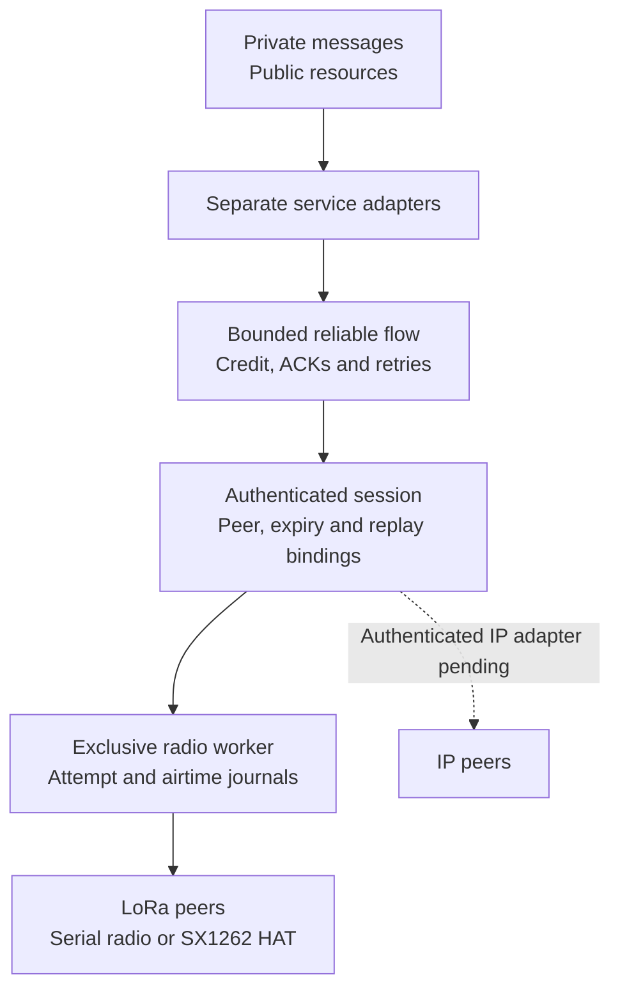

# Meshticulum

**Secure messages and verified resources across small radios and faster networks.**

A [SAGE Foundation](https://sage-foundation.net/) project, created and maintained by [Dhillon Andrew Kannabhiran (@l33tdawg)](https://github.com/l33tdawg). Part of the broader [SAGE project](https://github.com/l33tdawg/sage/).

Meshticulum is an experimental transport and resource system for networks that mix LoRa and IP. We are building it to close the gap between practical embedded radio meshes and richer, secure networking across different transports—and to move more useful encrypted data through the radio time we have.

It began in SAGE Lantern and now lives as a standalone project. The transport, public-resource and offline envelope code work without SAGE. SAGE remains an optional application integration.

## SAGE project family

| Project | Repository and scope |
| --- | --- |
| **SAGE** | [Main SAGE repository](https://github.com/l33tdawg/sage/) — agent memory, governance and core infrastructure. |
| **Meshticulum** | [This repository](https://github.com/l33tdawg/meshticulum) — reusable transport, reliable flow, radio/IP carrier work and verified resource protocols. |
| **Lantern** | **A separate Lantern-specific repository is planned** for the product apps/UI, device provisioning, runtime orchestration and device integrations. Its link will be added when that repository is ready. |

The planned Lantern repository will consume Meshticulum as an independent transport dependency. Historical Lantern lab helpers and optional integration adapters remain here during the transition; the product split is not yet complete. See [attribution and repository boundaries](docs/PROJECT_FAMILY.md).

## Why build this?

[MeshCore](https://github.com/meshcore-dev/MeshCore) brings lightweight multi-hop packet routing to embedded LoRa and other packet-radio devices. [Reticulum](https://reticulum.network/) provides a broader cryptographic networking stack for local and wide-area networks, including links with very little bandwidth. Both are valuable starting points for a network that must work away from reliable infrastructure.

Meshticulum combines those priorities in its own design: small, bounded radio transfers; explicit authenticated peers and services; and resources that can move across different paths while keeping their content identity. A private message should stay encrypted to its intended recipient as it crosses a relay. A public knowledge pack should be verifiable no matter which peer supplied its chunks. If IP becomes available, the network should use its measured advantage; if it disappears, verified work should survive the change of path.

This is a bridge between **design strengths**, with a separate Meshticulum protocol. Compatibility with existing MeshCore or Reticulum wire formats is not implemented. See [Why Meshticulum](docs/WHY.md) for the motivation and [the comparison](docs/COMPARISON.md) for the differences, tradeoffs and upstream references.

## Architecture at a glance



[Editable Mermaid](docs/diagrams/readme-1.mmd) · [Rendered SVG](docs/diagrams/readme-1.svg)

The solid path is implemented source composition; the dotted IP branch is the next transport implementation and qualification step. The diagram describes components, rather than a completed hardware deployment.

Two service paths sit above the flow:

- **Private messages:** recipient-encrypted, sender-signed envelopes. The compact binary carrier preserves the encrypted and signed bytes. Protected admission, durable capture and uncertain-write recovery live in the optional SAGE adapter.
- **Public resources:** signed manifests and content-addressed chunks. Bounded MR1 requests and replies move blocks over a scarce carrier; publisher and content verification determine which chunks enter the reusable cache.

Below them, admission binds each transfer to its peers, service, object and original expiry. Receiver credit bounds what can enter the flow. The scheduler and exclusive worker account for DATA, ACKs, retries and shared-medium costs. Local RF completion, peer receipt and application acceptance remain separate observations.

[Architecture](docs/ARCHITECTURE.md) follows a transfer through these boundaries and shows the intended mixed-path topology.

## How we aim to make it faster

The goal is higher **useful encrypted goodput**: application bytes delivered under verification, rather than raw modem bitrate. In the retained radio bench, the timed interval ends at the sender's flow ACK; the receiver's durable hash is required separately. The design reduces avoidable carrier overhead through compact binary envelopes, bounded windows, selective acknowledgements and explicit receiver credit. Retry timing takes the carrier queue into account, and the request/reply adapters avoid carrying HTTP and base64 framing over the scarce radio link.

For public resources, the path policy uses local verified request timings and shared-bottleneck information. It can retain verified chunks and select among explicitly supplied routes; it does not equate an interface name with a fast path. Authenticated IP transport and real mixed-path failover still need qualification.

Retained single-radio bench runs from 2026-10-09 recorded about **1.2 kB/s median useful encrypted goodput** across C→A, C→B and A→B LoRa links, with 30 completed RF samples. That is evidence from an earlier experimental runtime, and the current service runner still needs its own hardware qualification. The programme target is **1–1.5 kB/s**; matched MeshCore and Reticulum measurements remain to be collected.

[Performance](docs/PERFORMANCE.md) explains the available evidence, units, measurement boundaries and the matched comparisons still required.

## What works today?

| Area | Implemented source | Next qualification |
| --- | --- | --- |
| Reliable transport | MT05 flow composed with session authentication, bounded credit and queues, ACK/retry behavior, durable replay and attempt journals | Current hardware timing, completed radio transfers and settled worker debt |
| Radio adapters | Exclusive serial-radio and Linux SX1262 workers; finite public service runner | Coordinated device runs with bounded disarm and rollback |
| Public resources | Signed manifests, content checks, bounded MR1 blocks, verified-piece resume and measured path policy | C→A LoRa→B IP, IP loss, fresh LoRa admission and return to the faster measured path |
| Private messages | Offline encrypted envelopes and compact binary carrier; optional protected SAGE capture/inbox adapters | Real native ownership, encrypted backend, consent and recovery behavior |
| Standalone packaging | Canonical Python package, public host-runtime builder and SDK-free source suite | Reproducible firmware/BSP recipe and release review |

At the standalone extraction checkpoint, **1,676 SDK-free source controls** and **258 optional SAGE integration controls** passed. [CI](.github/workflows/tests.yml) runs the standalone suite and frozen-flow check on Python 3.11, 3.12 and 3.13. These checks support the source behavior; current-runtime hardware qualification, full mixed-path operation and production private admission remain open. The [roadmap](docs/ROADMAP.md) tracks that work.

## Install and explore

Python 3.11 or later is required. The offline core runs on a development host; radio workers and Linux device entry points need the corresponding hardware interfaces.

```sh
git clone https://github.com/l33tdawg/meshticulum.git
cd meshticulum
python -m venv .venv
. .venv/bin/activate
python -m pip install -e '.[dev]'
python -m pytest --ignore=tests/integrations
python tools/verify_frozen_flow.py
```

Start with the canonical package imports:

```python
from meshticulum.contracts.identity import PeerID
from meshticulum.privacy.mesh_binary_envelope import to_binary, to_text
from meshticulum.resources.resource import BlockReader, BlockServer
```

`BlockReader` uses a caller-supplied, bounded exchange that must enforce authentication, admission and the absolute deadline. `BlockServer` reads from a caller-owned verified public-resource allowlist. The envelope conversion helpers change the carrier representation while preserving the sealed content; they do not create a transport session.

The CLI help is safe to inspect:

```sh
meshticulum-service --help
meshticulum-seed --help
```

A radio service run needs a separately provisioned finite grant and the trusted exclusive worker. Follow [Hardware](docs/HARDWARE.md) before operating devices, and [SAGE integration](docs/SAGE_INTEGRATION.md) for the compatible local SDK and private-adapter controls. Source tests use synthetic identities and explicit source models; they do not flash radios or start production services.

## Repository map

| Location | Responsibility |
| --- | --- |
| `src/meshticulum/contracts` | Peer, service, session, route, limit and deadline contracts |
| `src/meshticulum/scheduler` | Admission, attempt settlement and medium budgeting |
| `src/meshticulum/flow` | Accepted bounded reliable-flow and finite-port candidate |
| `src/meshticulum/bench` | Authenticated frames, journals, workers and finite service runners |
| `src/meshticulum/resources` | Signed public packs, block exchange, verified cache and path policy |
| `src/meshticulum/privacy` | Offline recipient-encrypted envelopes and binary carrier |
| `src/meshticulum/integrations/sage` | Optional protected inbox, capture and storage adapters |
| `firmware/meshticulum-bench` | Raw LoRa coprocessor source and experimental lab tooling |
| `tests` | Acceptance and failure controls, including optional integration controls |

New code should use `meshticulum.*` imports. Small compatibility bridges preserve the module and class identity of the unchanged accepted flow. [Extraction and provenance](docs/EXTRACTION.md) records the original source, namespace changes and frozen hashes.

## Read more and contribute

[Documentation home](docs/index.md) · [Why](docs/WHY.md) · [Architecture](docs/ARCHITECTURE.md) · [MeshCore/Reticulum comparison](docs/COMPARISON.md) · [Performance](docs/PERFORMANCE.md) · [Roadmap](docs/ROADMAP.md)

Before changing transport behavior, read [AGENTS.md](AGENTS.md), run the standalone suite and verify the frozen-flow pins. Changes to the accepted flow and port require a reviewed revision. Keep original deadlines, replay decisions and attempt debt intact across cancellation and restart, and preserve failed or unavailable measurements alongside successful runs.

Meshticulum is licensed under [Apache-2.0](LICENSE), with inherited attribution in [NOTICE](NOTICE). MeshCore-derived board support and other third-party components retain their own licenses; the standalone firmware recipe and license inventory are still being completed.
