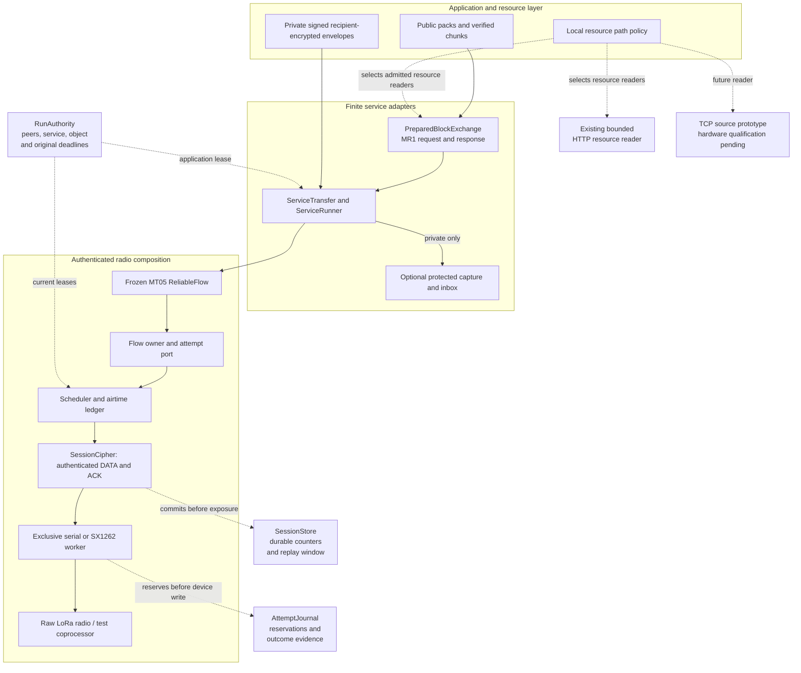
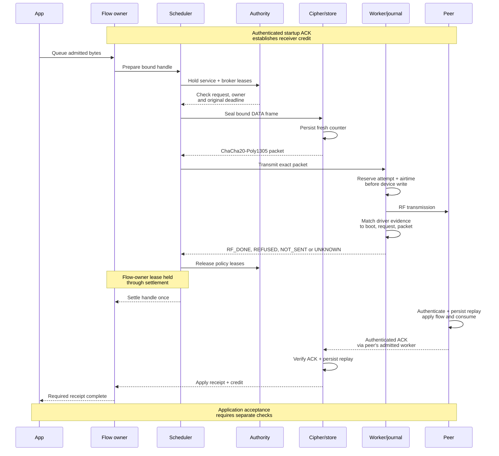
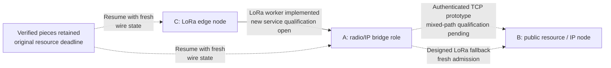

# Meshticulum architecture

Meshticulum separates what an application wants to transfer from how a scarce link can safely carry it. A public resource, a private message, a reliable flow, a radio attempt and an application admission each have their own boundaries. That separation lets the same resource logic use different carriers while keeping peer identity, expiry, receiver capacity and medium cost explicit.

The current implementation is an experimental, authenticated **finite-transfer system**, with serial and Linux SX1262 adapters. Earlier paired-radio runs provide retained physical evidence for their pinned encrypted bench runtime; they do not qualify the newer public MR1 service runner, protected application bindings or the full mixed-path network. The broader design combines small-radio operation with verified resources and mixed LoRa/IP paths. It does not currently translate MeshCore or Reticulum wire protocols, and an authenticated TCP source prototype now exists, with device and mixed-path qualification pending; see [IP transport](IP_TRANSPORT.md).

## The layers

Solid arrows below show the implemented finite radio composition. Dashed arrows show dependencies, durable state or the separately identified HTTP resource path.

[Editable Mermaid](diagrams/architecture-1.mmd) · [Rendered SVG](diagrams/architecture-1.svg)

| Layer | Responsibility | Source |
| --- | --- | --- |
| Identity and contracts | Full peer/session/flow/route bindings, service capabilities, byte limits and original deadlines | [`contracts/identity.py`](../src/meshticulum/contracts/identity.py), [`contracts/negotiation.py`](../src/meshticulum/contracts/negotiation.py) |
| Scheduling | Bounded queues, local traffic classes, current service and broker leases, flow-owned attempts and medium reservations | [`scheduler/scheduler.py`](../src/meshticulum/scheduler/scheduler.py), [`scheduler/budget.py`](../src/meshticulum/scheduler/budget.py) |
| Reliable flow | Fragmentation, receipt, selective ACKs, receiver credit, retries and bounded failure | [`flow/flow.py`](../src/meshticulum/flow/flow.py), [`flow/flow_port.py`](../src/meshticulum/flow/flow_port.py) |
| Authenticated composition | Connect the frozen flow to authority, cipher, journals and worker | [`bench/flow_runtime.py`](../src/meshticulum/bench/flow_runtime.py) |
| Radio workers | Exclusive device access, finite arm/disarm, exact attempt evidence and retained debt | [`bench/serial_worker.py`](../src/meshticulum/bench/serial_worker.py), [`bench/hat_worker.py`](../src/meshticulum/bench/hat_worker.py) |
| Services | Bind complete bounded bytes to a pre-admitted public or private use | [`bench/services.py`](../src/meshticulum/bench/services.py), [`bench/service_runner.py`](../src/meshticulum/bench/service_runner.py) |
| Public resources | Publisher trust, content verification, durable resume and local path selection | [`resources/knowledge_pack.py`](../src/meshticulum/resources/knowledge_pack.py), [`resources/lamplighter.py`](../src/meshticulum/resources/lamplighter.py), [`resources/swarm.py`](../src/meshticulum/resources/swarm.py) |
| Private application integration | Protected replay/admission and uncertain-write recovery | [`integrations/sage/mesh_inbox.py`](../src/meshticulum/integrations/sage/mesh_inbox.py), [`integrations/sage/mesh_binary_capture.py`](../src/meshticulum/integrations/sage/mesh_binary_capture.py) |

The `bench` name reflects the implementation's qualification stage. It contains the actual experimental wire and worker composition, rather than only a performance harness. Importing those modules does not enroll peers, provision keys, acquire hardware or start a transfer.

## Identity and authority follow the transfer

A `PeerID` is the full chain identifier and 32-byte signing-key identifier. A `SessionKey` binds both peers plus separate 16-byte session and generation values. `FlowKey` adds the initiating peer and flow number; `RouteBinding` adds the service provider, carrier instance, carrier/profile digests and route generation. Compact identifiers on the air are references into these bindings, rather than independent permission.

`negotiate()` parses capabilities, intersects limits and requires trusted host callbacks for transcript authentication and current service authorization. Parsing an offer does not authenticate it. Its `NegotiatedContract` is an admission snapshot: every later dispatch still needs current authority. The general contract API does not supply an autonomous discovery or handshake daemon. The current radio runner instead uses operator-provisioned, finite pairwise grants through [`RunAuthority`](../src/meshticulum/bench/authority.py).

The service grant binds the exact peers, host boot, radio profile, object size and digest, service format and original application expiry. It is claimed once. Dispatch holds the grant's revocation lock together with the broker/owner checks through the bounded attempt. Replacing files, retiring the grant, losing the owner, changing boot or crossing an original epoch or monotonic deadline refuses new work.

Service kinds and traffic classes are local policy. Public knowledge is bulk; protected messages are interactive. A remote label cannot promote traffic to the control lane or authorize a backhaul service. Internet and SAGE federation appear in the contract vocabulary, but the current finite runner does not implement their required live incremental stream and half-close behavior. A raw transport stream also does not replace SAGE's pinned TLS and federation authorization.

## Reliable flow and radio attempts are different state machines

The accepted MT05 flow implements a bounded window, fragmentation, cumulative receipt plus a fixed 32-bit selective bitmap, receiver credit, retransmission and credit-recovery controls. Credit represents receiver capacity; it is not added again when an old ACK or retransmission arrives. Held reorder frames and unconsumed delivered bytes count against that capacity. ACK revisions describe the entire receipt/credit snapshot, so stale statements cannot release capacity through a side effect.

[`MeshticulumFlowOwner` and `FlowPortLink`](../src/meshticulum/flow/flow_port.py) connect every output lane to the scheduler. New DATA, retransmitted DATA, probes and ACKs use that path. The flow owner permits one live attempt handle and reconciles its result once. Refusal before send does not spend logical receiver credit; accepted or unknown attempts retain their accounting. The explicit sending fence covers every lane.

The flow and port are frozen under accepted source pins. Namespace bridges preserve their class identity; [`verify_frozen_flow.py`](../tools/verify_frozen_flow.py) checks the pinned bytes. The historical [flow revision notes](../src/meshticulum/flow/README.md) describe the isolated candidate and its review history. The later `BenchFlow` composition supplies authentication and workers without rewriting that candidate.

The scheduler bounds frames and bytes at flow, peer and global levels. It separates locally selected interactive, bulk and control queues, and requires both service and broker leases for dispatch. Its ledger distinguishes the node's own transmit cost from shared-medium cost, including forward transmission, firmware ACK allowance and reverse control. A worker reservation or calculated profile is accounting evidence with a declared basis; it is not a measured RF counter.

### One DATA attempt and its ACK

This diagram follows the successful radio path. Before sending new DATA, the sender receives an authenticated startup credit statement from the receiver through the same admitted reverse pipeline. Neither endpoint fabricates the other's capacity.

[Editable Mermaid](diagrams/architecture-2.mmd) · [Rendered SVG](diagrams/architecture-2.svg)

`RF_DONE` means the matching local driver reported completion of that RF attempt. Peer receipt requires an authenticated ACK. Public publisher verification and protected inbox admission require their own subsequent checks. A serial write, a socket write or an RF completion cannot substitute for those later stages.

Unknown device outcomes fence the worker and retain original attempt/airtime debt. The journal commits a reservation before the device write, so a process crash cannot erase an attempted transmission. New grants, queue cancellation, runner closure and object resumption do not refund old physical debt. The native owner must independently establish disarm, cleanup and settlement.

## Authenticated wire and replay persistence

[`SessionCipher`](../src/meshticulum/bench/wire.py) wraps DATA and ACKs in ChaCha20-Poly1305. HKDF derives separate directional keys from a provisioned pairwise secret and a context containing full peers, session incarnation, service, route binding, limits and expiry. The authenticated header carries kind, direction, session reference, counter and length. There is no unauthenticated fallback.

[`SessionStore`](../src/meshticulum/bench/state.py) reserves transmit counters durably before encryption and commits a receive replay decision before returning plaintext. Every retry receives a new outer counter; the reliable flow's inner sequence still identifies the logical frame being retried. A forged frame cannot move the replay window. A crash after replay commit may lose delivery to the flow, so the peer must retry the logical frame with a fresh outer packet.

The store binds its state to the grant, direction and original host boot, checks epoch and monotonic continuity, and retires rather than reopening spent sessions. SQLite with durable settings supplies process-crash persistence. Deployment must separately protect the state directory against deletion and rollback; SQLite alone does not provide hardware-backed rollback resistance.

The current radio composition caps an outer packet at **255 bytes**. Its header and AEAD tag leave **208 bytes** for the inner flow frame; the current DATA encoding leaves **193 useful bytes**. `BenchFlow` adds finite one-way transfers, a maximum of four frame slots and radio-profile pacing/ACK coalescing. Those choices and source airtime estimates are experimental policy, rather than a general IP framing scheme or a proven optimum.

## Public resources: trust survives a carrier change

The public-resource layer starts with a pinned publisher/trust root, signed manifest and content hashes. [`knowledge_pack.py`](../src/meshticulum/resources/knowledge_pack.py) validates the pack format and signature; [`lamplighter.py`](../src/meshticulum/resources/lamplighter.py) verifies complete bounded batches and retains verified chunks for resume. The server reads an explicit public-resource allowlist. Availability reports help selection, but do not authenticate chunk contents.

[`MR1`](../src/meshticulum/resources/resource.py) transports a resource name, block offset and size in compact binary requests. Responses bind to the exact request and range. The small carrier moves raw resource bytes; JSON/Base64 batch wrappers are reconstructed locally for existing batch verification. The MR1 codec supplies neither peer authentication nor radio authority; the admitted transport below it owns those controls.

`PreparedBlockExchange` composes separately admitted request and response flows with reversed peers, independent sessions and the same original resource expiry. It rejects a caller deadline tighter than the actual dispatch admissions. Polling a shorter timeout cannot retroactively shorten a hardware lease.

There are two distinct storage boundaries:

- [`VerifiedChunks`](../src/meshticulum/bench/objects.py) checks management-provisioned synthetic/public chunk descriptors and whole-object hashes. It can reuse verified content under a new session, but cannot reuse the old nonce or attempt state.
- The public Linux service runner writes received bytes to a bounded, durable quarantine. Its receipt explicitly leaves `publisher_verified` false. A separately owned public verifier must establish publisher and manifest trust before publication or caching. Transport authentication alone does not establish that trust.

### Choosing and resuming paths

[`resources/swarm.py`](../src/meshticulum/resources/swarm.py) represents a route as adjacent hops with local shared-resource identifiers. Initial cost estimates sum store-and-forward hop time. Fresh, locally verified request timing trains the path estimator; transport names and advertised rates do not decide which route is faster.

The downloader chooses predicted finish time while considering work on shared bottlenecks. It allows one in-flight batch per path, avoids speculative duplicate traffic on scarce links, and validates the entire batch before committing it. Failed paths are excluded for the current transfer; verified chunks remain reusable after cancellation or failure and are checked again on resume. A rebound route needs a fresh `Source` and route generation, so measurements cannot silently follow a different carrier binding.

This policy expects an **already admitted** reader enforcing its byte limit and absolute deadline. It does not open a radio, authorize a route, migrate a live wire session or refund airtime. The existing bounded HTTP reader and loopback tests demonstrate resource behavior over HTTP. They do not establish the TCP prototype's device integration or physical mixed-path operation.

## Private messages: two encryption boundaries

Private content has recipient encryption and sender authentication independently of the hop transport. [`mesh_envelope.py`](../src/meshticulum/privacy/mesh_envelope.py) signs the canonical inner message with Ed25519 and seals it to the pinned recipient using PyNaCl's SealedBox. An intermediate carrier can forward the sealed record while its own link/session encryption protects that hop. The sender/recipient bindings and signature domains remain those of the inherited envelope protocol.

[`mesh_binary_envelope.py`](../src/meshticulum/privacy/mesh_binary_envelope.py) replaces only the outer text prefix and Base64 representation with a three-byte binary selector plus the **same ciphertext**. It reduces carrier bytes without changing encryption or signatures. Conversion is a bounded codec operation, not authentication or an automatic negotiation/fallback mechanism. Recipient verification, expiry, consent and durable replay admission still follow.

The optional SAGE adapter adds protected storage and lifecycle controls. `PrivatePolicy` must hold a native owner/consent/revocation lease for the exact grant. `BinaryCapture` persists the original receive intention before DATA/ACK dispatch, then durably records the complete, already sealed bytes before inbox processing. Recovery retains the original operation, boot, grant and epoch/monotonic deadlines. It first reconciles an existing signed inbox result; historical capture time or a later grant cannot authorize fresh expired admission.

Private messages never enter `BlockServer` or public verified caches. The public Linux launcher refuses private MESSAGE grants. A source test with a modeled lease or SDK MockTransport cannot qualify the real protected backend. Core contracts, resource code and offline envelope conversion require no SAGE SDK; see [SAGE integration](SAGE_INTEGRATION.md) for the separately supplied adapter dependencies and open gates.

## Designed mixed-path network

The following topology is **designed, not qualified**. A/B/C are lab roles. The solid RF edge has an implemented worker path and historical bench evidence; the new public-service composition and dashed IP/fallback paths require fresh admission and physical validation.

[Editable Mermaid](diagrams/architecture-3.mmd) · [Rendered SVG](diagrams/architecture-3.svg)

The intended qualification exercises C→A over LoRa followed by A→B over authenticated IP; IP loss followed by a newly admitted LoRa path and verified-piece resume; and return to the locally measured faster IP route. Each path must preserve the original resource deadline and peer/service binding. IP bytes need their own accounting: a socket write must not become `RF_DONE`, and IP cost must not be charged as invented radio airtime.

This is a bridge between the operating needs of small-radio meshes and transport-independent applications. It is not yet a packet gateway into either MeshCore or Reticulum. Any future interoperable adapter must define which identities, services, permissions and delivery stages cross that boundary; matching a radio setting or carrying bytes is insufficient.

## What evidence completes the architecture

Standalone tests cover contract rejection, credit/replay behavior, durable source journals, modeled worker failures, publisher checks and resource resume. The native C++ harness checks synthetic serial input against the test coprocessor source. These are useful source controls with narrower scope than hardware operation.

Physical qualification still needs current exclusive device ownership, finite grants, matched frame/ACK evidence, bounded disarm/rollback and retained raw failures. Mixed-path tests must include actual authenticated IP, fresh failover admission and measured route return. Private enablement additionally needs the real encrypted backend and native lifecycle authority. Sustained goodput and comparisons require matched hardware, settings, useful encrypted payloads and total request/response/ACK/retry cost. See [hardware tooling](HARDWARE.md) and [remaining qualification](ROADMAP.md).
