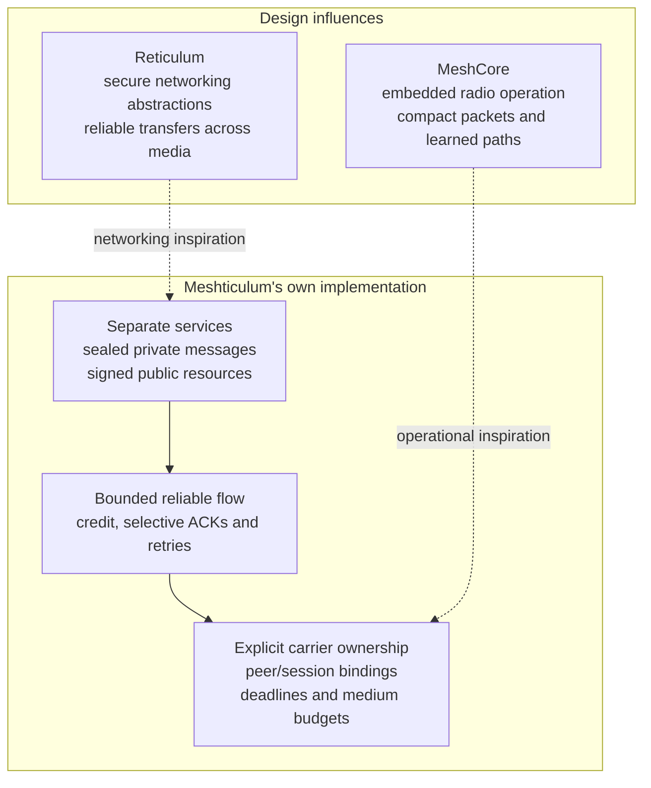

# MeshCore, Reticulum and Meshticulum

MeshCore and Reticulum overlap in encrypted, resilient communication over constrained links, but their primary abstractions differ. MeshCore centers embedded packet-radio nodes and their routing roles. Reticulum centers cryptographic destinations and a networking stack that can span different media. Meshticulum explores a combination of those ideas, with explicit application, queue, credit, expiry and medium-budget boundaries.

This comparison describes scope and design, not a performance ranking. Meshticulum is experimental; the upstream projects have established implementations and ecosystems. [Performance evidence](PERFORMANCE.md) records the narrower claims supported by current measurements.

## Core differences

| Concern | MeshCore | Reticulum | Meshticulum today |
| --- | --- | --- | --- |
| Main abstraction | Lightweight C++ packet-radio framework with companion, repeater and room-server examples. [Project](https://github.com/meshcore-dev/MeshCore) | Secure networking stack with destinations, packets, links and higher-level transfer APIs. [Overview](https://reticulum.network/manual/whatis.html) | Python host implementation of bounded authenticated flows, service adapters and verified resources; experimental radio coprocessor and Linux HAT adapters. |
| Media and deployment | Particularly focused on embedded LoRa devices. BLE, USB or Wi-Fi companion connections connect a client to its radio; those connections alone are not a general mixed-media routed overlay. The project also includes a KISS modem example. [Examples and clients](https://github.com/meshcore-dev/MeshCore#-how-to-get-started) | Reference stack runs in userland on Python hosts. Interfaces include RNode LoRa, serial, TCP and UDP, and networks can combine them. [Interface guide](https://reticulum.network/manual/interfaces.html) | Raw LoRa serial/SX1262 workers and transport-neutral public-resource readers exist. HTTP resource transfers exist; authenticated IP service transport and the complete mixed-path deployment remain open. [Roadmap](ROADMAP.md) |
| Routing | Flood routing can discover a recipient path; the returned path is stored and embedded in later direct packets. Companion clients do not repeat; repeater roles forward traffic. Group channels normally flood. [Routing FAQ](https://docs.meshcore.io/faq/#54-q-how-does-a-node-discover-a-path-to-its-destination-and-then-use-it-to-send-messages-in-the-future-instead-of-flooding-every-message-it-sends-like-meshtastic) | Signed destination announcements establish next-hop reachability. Each Transport node knows a next hop, rather than a complete source route. Forwarding is an explicitly enabled node role. [Transport](https://reticulum.network/manual/understanding.html#reticulum-transport) | Routes are explicit local descriptions, not authenticated discovery. The resource scheduler predicts completion from verified timing samples and shared bottlenecks. It does not migrate a live cipher session. [Path policy](../src/meshticulum/resources/swarm.py) |
| Reliable data | Message acknowledgements, returned paths, requests/responses, group datagrams and multipart/custom packet types are available. That leaves room for application-specific protocols beyond chat. [Payloads](https://github.com/meshcore-dev/MeshCore/blob/a366955cb2f67b8e6842d4f00d2b6a554dddd88a/docs/payloads.md), [packet types](https://docs.meshcore.io/packet_format/) | Resources handle packetization, sequencing, retransmission, integrity and reassembly over an established Link. Channels provide reliable messages. [Resources](https://reticulum.network/manual/understanding.html#resources), [Channel API](https://reticulum.network/manual/reference.html#channel) | MT05 supplies receiver credit, selective acknowledgements and bounded retries. MR1 binds each bounded resource response to its request; signed manifests and hashes establish public-object acceptance. [Flow](../src/meshticulum/flow/flow.py), [MR1](../src/meshticulum/resources/resource.py) |
| Identity and security | Node advertisements carry Ed25519 signatures; direct-message payloads are encrypted. Group text uses a shared channel key, and its displayed sender name is unsigned text that any key holder can choose. [Payload format](https://github.com/meshcore-dev/MeshCore/blob/a366955cb2f67b8e6842d4f00d2b6a554dddd88a/docs/payloads.md) | Links verify the destination and establish ephemeral encryption keys with forward secrecy. An initiator can remain anonymous or identify to the destination inside the encrypted link. [Link establishment](https://reticulum.network/manual/understanding.html#link-establishment-in-detail), [identification API](https://reticulum.network/manual/reference.html#RNS.Link.identify) | Bench sessions use provisioned pairwise secrets, full peer/session bindings, ChaCha20-Poly1305 and durable counters. Private envelopes separately use recipient SealedBox encryption and sender signatures. Enrollment and trusted key provisioning remain outside those codecs. [Carrier](../src/meshticulum/bench/wire.py), [private envelope](../src/meshticulum/privacy/mesh_envelope.py) |
| Capacity and cost | Embedded queues and compact routing are part of its operating model; node statistics expose transmission counts and airtime. [Project principles](https://github.com/meshcore-dev/MeshCore#contributing), [statistics payload](https://github.com/meshcore-dev/MeshCore/blob/a366955cb2f67b8e6842d4f00d2b6a554dddd88a/docs/payloads.md#get-stats) | Interface configuration includes announce traffic limits and RNode airtime limits. Reticulum explicitly discusses protecting low-bandwidth links when joining unlike networks. [RNode settings](https://reticulum.network/manual/interfaces.html#rnode-lora-interface), [network design](https://reticulum.network/manual/networks.html) | Finite grants and exclusive worker reservations bind frame and airtime limits. Reverse acknowledgements and uncertain attempts retain debt. A separate IP cost model must not masquerade as radio airtime. [Scheduler](../src/meshticulum/scheduler/budget.py), [roadmap](ROADMAP.md) |

## How Meshticulum bridges the design space

[Editable Mermaid](diagrams/comparison-1.mmd) · [Rendered SVG](diagrams/comparison-1.svg)

The combination we seek is practical radio operation with richer secure application transfers. Meshticulum adds explicit service admission and a public-resource verifier that can reuse independently verified pieces. That is a deployment tradeoff to evaluate, rather than a claim that MeshCore cannot carry application data or Reticulum cannot operate efficiently on LoRa.

There is also an intentional difference in identity policy. Meshticulum's current finite service sessions bind named peers before dispatch; private admission independently checks the sender and recipient. Reticulum's ability to keep an initiator anonymous is a different capability, and is not something this project has reproduced merely by encrypting packets.

## Protocol and compatibility boundary

Meshticulum currently uses its own authenticated wire and raw LoRa coprocessor. The lab firmware build derives board support from a retained MeshCore-based tree; it does not run MeshCore's routing protocol. The core package does not import Reticulum, and it is not a Reticulum protocol implementation. See [hardware provenance](HARDWARE.md) and [extraction](EXTRACTION.md).

“Best of both worlds” describes the motivation. A MeshCore peer and a Reticulum peer do not become interoperable through the current Meshticulum code. Any future gateway would need a separately specified and tested boundary for identity, message semantics, resource verification, retries and failure behavior.

No matched hardware comparison currently establishes that Meshticulum is faster than either project. A fair comparison needs the same radios, modem settings, useful encrypted payloads, topology and finite budget, with request, response, acknowledgement and retry costs included. Faster PHY settings alone are not evidence of a faster protocol. See [performance](PERFORMANCE.md).

## Source baseline

This review used official project documentation and source on **2026-10-10**. The Reticulum manual presented itself as **1.5.5**. GitHub's API reported MeshCore `main` at [a366955](https://github.com/meshcore-dev/MeshCore/commit/a366955cb2f67b8e6842d4f00d2b6a554dddd88a) dated 2026-09-30, and the Reticulum public mirror's `master` at [e40191b](https://github.com/markqvist/Reticulum/commit/e40191b3d193b46b7f2d8a44424a594cd758839b) dated 2026-09-30. The immutable MeshCore payload links above were checked at that commit; the published manuals and other branch links can change.

These references establish what was reviewed. They are not flashed-firmware identities or benchmark version pins, and they do not substitute for testing upstream behavior on matched hardware.
