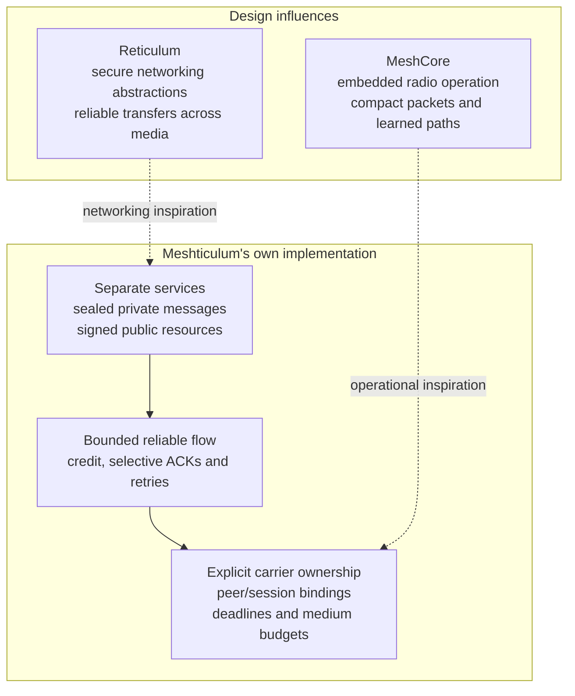

# MeshCore, Reticulum and Meshticulum

MeshCore and Reticulum overlap in encrypted, resilient communication over constrained links, but their primary abstractions differ. MeshCore centers embedded packet-radio nodes and their routing roles. Reticulum centers cryptographic destinations and a networking stack that can span different media. Meshticulum explores a combination of those ideas, with explicit application, queue, credit, expiry and medium-budget boundaries.

The competitive goal is to outperform both projects in useful delivery speed and security while combining practical radio operation with richer application transfers. Meshticulum is experimental; that goal exceeds what current evidence establishes. This comparison identifies the properties to evaluate, and [performance evidence](PERFORMANCE.md) records measured results and published upstream figures with their limits.

MeshCore and Reticulum are design inspirations, not wire-compatible peers of this implementation. Meshticulum's reusable protocol and resource code belongs here; [SAGE Lantern](https://github.com/l33tdawg/sage-lantern) owns native deployment and protected application integration. The dependency is one way: **Lantern → Meshticulum**. See the [SAGE Foundation attribution and project family](PROJECT_FAMILY.md).

## Core differences

| Concern | MeshCore | Reticulum | Meshticulum today |
| --- | --- | --- | --- |
| Main abstraction | Lightweight C++ packet-radio framework with companion, repeater and room-server examples. [Project](https://github.com/meshcore-dev/MeshCore) | Secure networking stack with destinations, packets, links and higher-level transfer APIs. [Overview](https://reticulum.network/manual/whatis.html) | Python host implementation of bounded authenticated flows, service adapters and verified resources; experimental radio coprocessor and Linux HAT adapters. |
| Media and deployment | Particularly focused on embedded LoRa devices. BLE, USB or Wi-Fi companion connections connect a client to its radio; those connections alone are not a general mixed-media routed overlay. The project also includes a KISS modem example. [Examples and clients](https://github.com/meshcore-dev/MeshCore#-how-to-get-started) | Reference stack runs in userland on Python hosts. Interfaces include RNode LoRa, serial, TCP and UDP, and networks can combine them. [Interface guide](https://reticulum.network/manual/interfaces.html) | Raw-radio serial/SX1262 workers support explicit LoRa and GFSK profiles; HTTP readers and authenticated TCP service transport also exist. Lantern recorded a finite 977-byte mixed request/reverse reply and a later 160-second loss/LoRa-resume/IP-return campaign verifying four pieces / 3,908 useful bytes. These are scoped native service results, not sustained capacity or an upstream speed ranking. [Native checkpoints](IP_TRANSPORT.md#recorded-native-public-resume-and-ip-return), [roadmap](ROADMAP.md) |
| Routing | Flood routing can discover a recipient path; the returned path is stored and embedded in later direct packets. Companion clients do not repeat; repeater roles forward traffic. Group channels normally flood. [Routing FAQ](https://docs.meshcore.io/faq/#54-q-how-does-a-node-discover-a-path-to-its-destination-and-then-use-it-to-send-messages-in-the-future-instead-of-flooding-every-message-it-sends-like-meshtastic) | Signed destination announcements establish next-hop reachability. Each Transport node knows a next hop, rather than a complete source route. Forwarding is an explicitly enabled node role. [Transport](https://reticulum.network/manual/understanding.html#reticulum-transport) | Routes are explicit local descriptions, not authenticated discovery. The resource scheduler predicts completion from verified timing samples and shared bottlenecks. It does not migrate a live cipher session. [Path policy](../src/meshticulum/resources/swarm.py) |
| Reliable data | Message acknowledgements, returned paths, requests/responses, group datagrams and multipart/custom packet types are available. That leaves room for application-specific protocols beyond chat. [Payloads](https://github.com/meshcore-dev/MeshCore/blob/a366955cb2f67b8e6842d4f00d2b6a554dddd88a/docs/payloads.md), [packet types](https://docs.meshcore.io/packet_format/) | Resources handle packetization, sequencing, retransmission, integrity and reassembly over an established Link. Channels provide reliable messages. [Resources](https://reticulum.network/manual/understanding.html#resources), [Channel API](https://reticulum.network/manual/reference.html#channel) | MT05 supplies receiver credit, selective acknowledgements and bounded retries. MR1 binds each bounded resource response to its request; signed manifests and hashes establish public-object acceptance. [Flow](../src/meshticulum/flow/flow.py), [MR1](../src/meshticulum/resources/resource.py) |
| Identity and security | Node advertisements carry Ed25519 signatures; direct-message payloads are encrypted. Group text uses a shared channel key, and its displayed sender name is unsigned text that any key holder can choose. [Payload format](https://github.com/meshcore-dev/MeshCore/blob/a366955cb2f67b8e6842d4f00d2b6a554dddd88a/docs/payloads.md) | Links verify the destination and establish ephemeral encryption keys with forward secrecy. An initiator can remain anonymous or identify to the destination inside the encrypted link. [Link establishment](https://reticulum.network/manual/understanding.html#link-establishment-in-detail), [identification API](https://reticulum.network/manual/reference.html#RNS.Link.identify) | Radio and IP sessions use provisioned pairwise secrets, peer/session bindings, ChaCha20-Poly1305 and durable counters. Private envelopes separately use static recipient SealedBox encryption and sender signatures. Neither path has proved forward secrecy; enrollment and trusted provisioning remain external. [Radio](../src/meshticulum/bench/wire.py), [IP](../src/meshticulum/ip/wire.py), [private envelope](../src/meshticulum/privacy/mesh_envelope.py) |
| Capacity and cost | Embedded queues and compact routing are part of its operating model; node statistics expose transmission counts and airtime. [Project principles](https://github.com/meshcore-dev/MeshCore#contributing), [statistics payload](https://github.com/meshcore-dev/MeshCore/blob/a366955cb2f67b8e6842d4f00d2b6a554dddd88a/docs/payloads.md#get-stats) | Interface configuration includes announce traffic limits and RNode airtime limits. Reticulum explicitly discusses protecting low-bandwidth links when joining unlike networks. [RNode settings](https://reticulum.network/manual/interfaces.html#rnode-lora-interface), [network design](https://reticulum.network/manual/networks.html) | Finite grants and exclusive worker reservations bind frame and airtime limits. Reverse acknowledgements and uncertain attempts retain debt. A separate IP cost model must not masquerade as radio airtime. [Scheduler](../src/meshticulum/scheduler/budget.py), [roadmap](ROADMAP.md) |

## How Meshticulum bridges the design space

[Editable Mermaid](diagrams/comparison-1.mmd) · [Rendered SVG](diagrams/comparison-1.svg)

The combination we seek is practical radio operation with richer secure application transfers. Meshticulum adds explicit service admission and a public-resource verifier that can reuse independently verified pieces. That is a deployment tradeoff to evaluate, rather than a claim that MeshCore cannot carry application data or Reticulum cannot operate efficiently on LoRa.

There is also an intentional difference in identity policy. Meshticulum's current finite service sessions bind named peers before dispatch; private admission independently checks the sender and recipient. Reticulum's ability to keep an initiator anonymous is a different capability, and is not something this project has reproduced merely by encrypting packets.

## Published performance comparison

The earlier **1,071.3 B/s** Meshticulum finite resource result is numerically **2.61×** the **410 B/s** earlier frame-ACK report by the same project author in [MeshCore issue #3404](https://github.com/meshcore-dev/MeshCore/issues/3404). Both state SF7/BW500, but the MeshCore report times individually acknowledged 128-byte frames and our result times a windowed resource reply. This supports a scoped comparison between published observations, not independent corroboration or a general speed or security ranking. Reticulum's cited **3.1 kbit/s** figure describes on-air bitrate under different settings; it is neither **3.1 kB/s** nor encrypted application goodput. [Performance](PERFORMANCE.md#comparison-with-published-figures) keeps the units, conditions and missing measurements explicit.

Six matched pairs on 18 October 2026 provide a same-payload SF7/SF8 comparison
on the public bench path. At BW500, CR4/5, 921.375 MHz and 0 dBm,
median sender-ARM-to-receipt time was **7.405 seconds for SF7** and
**11.340 seconds for SF8**, or **1.103 and 0.720 kB/s** of useful application
throughput. The observed SF7 advantage was **1.531×**. All 12 chunks and
authenticated receipts passed. The MCU's 1,024-attempt cap stood at 380 after
both campaigns, leaving 644 attempts of headroom, on one boot generation with
zero receive drops. This is a matched profile comparison on one near-bench
link, not a range result or an upstream ranking.

## Throughput design review, 30 October 2026

The current search of official documentation, release source and published
reports did not find a reproducible upstream LoRa file benchmark matching our
startup-inclusive boundary. This does not establish that no such result exists.
An eventual Meshticulum result above 2,800 useful B/s would meet our current
target; it would not by itself establish superiority over either project.

Reticulum's RNode interface calculates an on-air bitrate and supports SF5 on
compatible radios. Its common SF7 settings therefore do not establish its
fastest supported profile. The `rncp` sender starts its speed timer after link
setup, resource preparation and entry into transfer. Compare both stacks with
an external invocation-to-authenticated-completion timer, identical
incompressible file bytes and declared compression, rather than comparing that
display with our whole-file target.
[RNode interface](https://github.com/markqvist/Reticulum/blob/7f2b3b9b524c9386316379af1313b43a5e4f7a5d/RNS/Interfaces/RNodeInterface.py#L697),
[`rncp` timer](https://github.com/markqvist/Reticulum/blob/7f2b3b9b524c9386316379af1313b43a5e4f7a5d/RNS/Utilities/rncp.py#L711).

The source review supplies concrete design ideas:

| Upstream mechanism | Application to Meshticulum |
| --- | --- |
| MeshCore's MCU dispatcher handles queued radio work and local timing. [Dispatcher](https://github.com/meshcore-dev/MeshCore/blob/81dbae592ffad40b4212bc0b37e82b38da08f4bc/src/Dispatcher.cpp#L66) | Continue bounded MCU delegation. Our four-entry queue already drives admitted ciphertexts locally; the dormant batch prototype aims to amortize host admission and release. Its production integration and performance remain unqualified. |
| Reticulum Resources request missing part hashes, adapt their window and prepare subsequent segments during transfer. [Resource](https://github.com/markqvist/Reticulum/blob/7f2b3b9b524c9386316379af1313b43a5e4f7a5d/RNS/Resource.py#L58) | Preserve existing verified-piece inventory, selective recovery and bounded parallel planning. Measure preparation/transfer overlap and larger useful parts before adding another recovery mechanism. |
| Reticulum's encrypted Resource path encrypts a complete segment before packetizing it. [Resource preparation](https://github.com/markqvist/Reticulum/blob/7f2b3b9b524c9386316379af1313b43a5e4f7a5d/RNS/Resource.py#L343) | Investigate envelope overhead separately from the radio window. Changing our per-frame authentication needs its own protocol review; it is not a setting in the current batch prototype. |

These are architectural comparisons, not evidence that any one mechanism makes
an upstream stack faster. The [pipeline record](THROUGHPUT_PIPELINE.md) separates
implemented host wakeups, dormant MCU code, ideal estimates and missing physical
measurements. A comparable LoRa test must also declare actual preamble,
header/CRC mode, power, hop count, discovery state, link conditions and retries.
Matching SF/BW/CR alone is insufficient.

This throughput review pins MeshCore companion v1.18.0 / `81dbae5`, Reticulum
1.5.5 / `7f2b3b9`, and RNode firmware 1.86 / `9b39b6c`. The earlier security review
below retains its own source baseline. These source identities do not identify
firmware used in the historical measurements.
[MeshCore release](https://github.com/meshcore-dev/MeshCore/releases/tag/companion-v1.18.0),
[Reticulum release](https://github.com/markqvist/Reticulum/releases/tag/1.5.5),
[RNode release](https://github.com/markqvist/RNode_Firmware/releases/tag/1.86).

## Security properties and gaps

Stronger encryption security is an objective that needs a threat model and evidence for confidentiality, integrity, author authentication, replay handling and key compromise. Cipher names alone do not establish an overall security ranking. The current forward-secrecy gap is material:

| Property | MeshCore reviewed paths | Reticulum 1.5.5 | Meshticulum today |
| --- | --- | --- | --- |
| Forward secrecy for a direct session or Link | The reviewed `calcSharedSecret` path uses the local identity private key and peer identity public key; it does not show a fresh ephemeral exchange. This is a statement about that path, not every custom application. [Identity source](https://github.com/meshcore-dev/MeshCore/blob/a366955cb2f67b8e6842d4f00d2b6a554dddd88a/src/Identity.cpp) | Both Link endpoints generate ephemeral X25519 keys, derive the shared secret and verify the destination's signed proof. The manual documents forward secrecy for Links. [Pinned Link source](https://github.com/markqvist/Reticulum/blob/7f2b3b9b524c9386316379af1313b43a5e4f7a5d/RNS/Link.py), [manual](https://reticulum.network/manual/understanding.html#link-establishment-in-detail) | Directional keys derive from a provisioned grant secret with HKDF. There is no ephemeral key exchange or ratchet in these radio/IP codecs, so forward secrecy is not proved. [Radio cipher](../src/meshticulum/bench/wire.py), [IP cipher](../src/meshticulum/ip/wire.py) |
| Forward secrecy outside a live Link | Group traffic uses a shared channel key. The reviewed payload format does not establish forward secrecy for that mode. [Group format](https://github.com/meshcore-dev/MeshCore/blob/a366955cb2f67b8e6842d4f00d2b6a554dddd88a/docs/payloads.md) | Optional destination ratchets support link-less SINGLE packets. GROUP and PLAIN destinations do not offer forward secrecy. [Pinned destination source](https://github.com/markqvist/Reticulum/blob/7f2b3b9b524c9386316379af1313b43a5e4f7a5d/RNS/Destination.py), [destination modes](https://reticulum.network/manual/understanding.html) | The private envelope encrypts a separately signed message to a long-term recipient key. It has no recipient ratchet or proved recipient forward secrecy. [Envelope source](../src/meshticulum/privacy/mesh_envelope.py) |

SealedBox generates an ephemeral sender key, but the recipient decrypts with its long-term private key. From that construction, later compromise of the recipient key can expose captured sealed records; an ephemeral sender key alone does not provide recipient forward secrecy. Meshticulum authenticates the inner author separately with a signature. [SealedBox construction](https://doc.libsodium.org/public-key_cryptography/sealed_boxes)

Fresh nonces, session generations, counters and expiry enforce other useful boundaries; they do not supply forward secrecy. Meshticulum's durable replay controls also depend on protected state and operating-system rollback resistance. The [roadmap](ROADMAP.md) keeps cryptographic review, key lifecycle and native private qualification open before stronger security claims.

## Protocol and compatibility boundary

Meshticulum currently uses its own authenticated wire and raw-radio coprocessor, with explicit LoRa and GFSK profiles. The lab firmware build derives board support from a retained MeshCore-based tree; it does not run MeshCore's routing protocol. The core package does not import Reticulum, and it is not a Reticulum protocol implementation. See [hardware provenance](HARDWARE.md) and [extraction](EXTRACTION.md).

“Best of both worlds” describes the motivation. A MeshCore peer and a Reticulum peer do not become interoperable through the current Meshticulum code. Any future gateway would need a separately specified and tested boundary for identity, message semantics, resource verification, retries and failure behavior.

The [17 October public SDK file measurements](RADIO_SDK_MEASUREMENTS.md) reached **1.95–2.03 kB/s including sender startup** for two fresh 100 kB files on a direct GFSK250 link about one metre long. These are separate from the earlier LoRa samples and upstream figures; they do not establish equal range, a general speed ranking or stronger encryption security.

Evaluate the speed goal using Meshticulum's own qualified measurements and published upstream figures; running MeshCore and Reticulum benchmark campaigns ourselves is not required. Each comparison must disclose versions, radios, modem settings, topology, useful payload, encryption, timing boundaries and request/response/ACK/retry costs where available. Different workloads or missing boundaries limit the conclusion, and a published PHY rate is not useful encrypted application goodput. [Performance evidence](PERFORMANCE.md) records those distinctions and gaps.

## Source baseline

This review used official project documentation and source on **2026-10-10**. The Reticulum manual presented itself as **1.5.5**. The current Reticulum security-source review uses [7f2b3b9](https://github.com/markqvist/Reticulum/commit/7f2b3b9b524c9386316379af1313b43a5e4f7a5d), whose version file identifies 1.5.5. MeshCore source links use [a366955](https://github.com/meshcore-dev/MeshCore/commit/a366955cb2f67b8e6842d4f00d2b6a554dddd88a), reported by GitHub's API as `main` dated 2026-09-30. The earlier Reticulum mirror review at [e40191b](https://github.com/markqvist/Reticulum/commit/e40191b3d193b46b7f2d8a44424a594cd758839b), also dated 2026-09-30, is historical. Published manuals and other branch links can change.

These references establish what was reviewed. They are not flashed-firmware identities or benchmark version pins. Published performance results need their own provenance and measurement boundaries.
