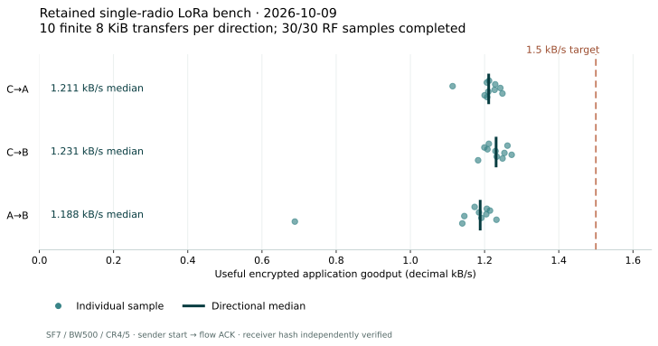

# Performance and measurement

The latest public SDK radio samples completed **two fresh 100,000-byte files at 2.03 and 1.95 kB/s (16.24 and 15.59 kbit/s) including sender startup**, plus a **23,900-byte file at 2.53 kB/s (20.28 kbit/s)**. They used **GFSK at 250 kbit/s**, on a direct HAT-to-MCU link about one metre apart. Both 100 kB intervals include all five sequential parts and coordination gaps. Scope issue through endpoint closure reached **1.86 and 1.76 kB/s (14.85 and 14.05 kbit/s)**. [The 17 October report](RADIO_SDK_MEASUREMENTS.md) gives the exact source, elapsed boundaries, confirmations and sanitized record.

On 18 October, source `1f85608` also completed fresh **250 kB, 500 kB and 1 MB signed bundles** on that path. Final sender-startup-inclusive rates were **2.111, 2.216 and 2.230 kB/s (16.889, 17.725 and 17.838 kbit/s)**; scope-to-closure rates were **2.063, 2.190 and 2.218 kB/s (16.500, 17.521 and 17.742 kbit/s)**. Every receiver independently verified every part and the exact whole file.

All three final files clear the owner's **2.0 kB/s (16 kbit/s)** whole-file
floor. The original 1 MB run reached 1.750 kB/s while its production LLM engine
held CPU4 at roughly 95%; that sample remains in the record as a host-contention
control. Excluding CPU4 from the benchmark process reduced mean part time from
10.97 to 8.66 seconds and raised the fresh 1 MB control to **2.230 kB/s**.
[The larger-file report](RADIO_SDK_MEASUREMENTS.md#where-the-1-mb-time-went)
retains both decompositions and exact arithmetic.

A first one-request HTTP gateway also carried `http://example.com/` from a
radio-only endpoint through a second endpoint's internet connection and back.
The body and both radio directions verified; a `links` text browser rendered the
page in **53.3 seconds**. The same request with a **30-second** timeout failed.
[The HTTP gateway record](HTTP_GATEWAY.md) keeps the receipts and limits; a warm
session is the next step toward a 30-second browser path.

These finite samples exceed the **1 kB/s (8 kbit/s) startup-inclusive alpha floor
for that path**, and the final 250 kB, 500 kB and 1 MB samples all exceed the
owner's 2.0 kB/s whole-file floor. The source-build alpha is published. A
sustained-throughput distribution, broader repetition and wider
[qualification](RELEASE_READINESS.md) remain open. The optional later 4 to
5 kB/s (32 to 40 kbit/s) stretch remains in the [roadmap](ROADMAP.md).

This page retains the earlier 30-sample LoRa distribution, seven finite native LoRa public samples and the 15 October GFSK campaign at their original source pins and timing boundaries. The new GFSK measurements are separate from the LoRa evidence and upstream comparison below.

## Retained radio results

These are the 2026-10-09 measurements from the earlier authenticated bench runtime. Each direction has ten separate finite transfers of 8,192 synthetic incompressible application bytes, with an independently required durable receiver hash. Rates include sender startup and receipt of the reliable-flow acknowledgement.

| Direction | Completed RF samples | Min / median / max goodput, B/s | Median / slowest observed transfer, seconds | DATA retries |
| --- | ---: | ---: | ---: | ---: |
| C→A | 10 / 10 | 1,113.9 / **1,211.1** / 1,248.2 | 6.764 / 7.355 | 0 |
| C→B | 10 / 10 | 1,182.6 / **1,231.1** / 1,273.1 | 6.654 / 6.927 | 0 |
| A→B | 10 / 10 | 688.5 / **1,188.2** / 1,232.0 | 6.894 / 11.898 | 4 |



All **30 RF samples completed**; **29 of 30 reached 1,000 B/s**. The slower A→B sample remains in the table and figure. Four DATA retransmissions occurred in that direction. The directional distributions stay separate; pooling them would hide the link and retry differences.

There were **31 management-session attempts**, including one SSH provisioning failure before RF. That failure is retained separately: RF-sample completion is 30/30, while managed-attempt completion is 30/31. At ten samples per direction, nearest-rank p95 is the slowest observed sample; it is not a population tail-latency guarantee.

The allowlisted per-run data, source capture hashes and aggregate values are in [radio-results.json](../benchmarks/2026-10-09-radio/radio-results.json). All 30 original `RUN.json` files and paired collected records were replayed offline through the [operator-capture analyzer now owned by Lantern](https://github.com/l33tdawg/sage-lantern/blob/codex/meshticulum-boundary/firmware/meshticulum-bench/analyze_runs.py); their per-direction summaries matched the retained report exactly. That replay checks capture consistency. The original operator captures remain in the lab workspace; the published metadata does not independently attest the hardware or contain grants, secrets, device addresses, boot identities or payload content.

## Native public resource transfers: 2026-10-11

Seven later finite transfers carried fresh, signed public resource pieces through the extracted Meshticulum runtime and Lantern's native integration. Both endpoints completed each response, the recipient independently verified the publisher/content and durable response, and the sample's native jobs were terminal. These are separate accepted samples at different source/runtime pins, not a repeated distribution or sustained-capacity result.

| Direction | Useful / MR1 response bytes | Sender start → flow ACK, seconds | Useful goodput, B/s | DATA frames ACKed / retries | Request → publisher verification, seconds |
| --- | ---: | ---: | ---: | ---: | ---: |
| B→C | 16,356 / 16,384 | 20.910 | **782.2** | 85 / 6 | 74.899 |
| A→C | 16,356 / 16,384 | 23.096 | **708.2** | 85 / 7 | 76.077 |
| C→A | 16,356 / 16,384 | 16.773 | **975.1** | 85 / 4 | 69.710 |
| C→A | 8,164 / 8,192 | 8.716 | **936.7** | 43 / 0 | 61.660 |
| C→A | 16,356 / 16,384 | 16.410 | **996.7** | 85 / 0 | 85.323 |
| C→A | 16,356 / 16,384 | 15.774 | **1,036.9** | 85 / 0 | 82.072 |
| C→A | 16,356 / 16,384 | 15.268 | **1,071.3** | 85 / 0 | 80.731 |

Useful goodput excludes the **28-byte MR1 response header** and divides verified block bytes by the sender's own start-to-ACK interval. Request-to-verification uses the requesting recipient's own clock and includes management and final-ACK windows; its corresponding useful rates are **218.4, 215.0, 234.6, 132.4, 191.7, 199.3 and 202.6 B/s**. Neither interval subtracts clocks across hosts. These public resources travel inside the authenticated encrypted session; they do not exercise a private inbox or native forward-secrecy exchange.

Here the recorded block size is the **serialized public resource**, including its JSON fields. It is not decoded file throughput. A proper 100,000-byte or 1,000,000-byte bundle result must count the original decoded file bytes, verify their exact whole-file SHA-256, and report Base64, JSON, signatures and padding as overhead. Those larger bundles, and the later 32 KiB candidate, have no completed native result in this seven-sample record.

The latest listed execution uses Core `6e722812c2efbfcdd18b56e3994588d18f9f7adc` with Lantern `63623ac63c25e4253ccabc62527c7dedb1a8ab37`. These historical IDs identify the measured source pair; the clean public history has separate commit identities. Newer 32 KiB and bundle source candidates do not inherit this qualification merely by passing tests.

The modem settings were **SF7/BW500/CR4/5, 921.375 MHz, eight-symbol preamble and 0 dBm chip setting**. Actual RF airtime, energy and EIRP remain **null**. The [sanitized success record](../benchmarks/2026-10-11-native-public/successes.json) keeps each paired Core/Lantern commit, archive/manifest and source-result hash, byte counts, timing, retries and sample/campaign status. The accepted B→C response was part of a larger campaign that did not wholly complete; the other six request/reply campaigns completed. The latest response acknowledged all **85 DATA frames with 85 RF_DONE attempts and zero DATA retries**. All four native drivers disarmed and all 21 management RPC clients completed; application start through cleanup took **136.779 seconds within the original 180-second window**. The two consecutive results of **1,036.9 and 1,071.3 B/s (1.037 and 1.071 kB/s)** meet the **1,000 B/s minimum for these finite samples**, while the preceding 996.7 B/s sample did not. Their Core transport source is unchanged; the **3.3% difference is observed run variation**. Two finite samples do not establish sustained goodput or a completion distribution. Full transport, sustained-goodput and native private forward-secrecy qualification remain open. This record leaves the earlier 30-sample report and verifier unchanged.

The latest **1,071.3 B/s** useful result is numerically **2.61×** the **410 B/s** contributor result in [MeshCore issue #3404](https://github.com/meshcore-dev/MeshCore/issues/3404). That issue reports 25 individually acknowledged 128-byte frames at SF7/BW500; this sample is a bounded resource reply with windowed flow and independent publisher verification. The workloads and timing boundaries differ, so the ratio is not a general network ranking. The RNode author's [Reticulum guide](https://unsigned.io/rnode_bootstrap_console/guides/loracomms.html) reports **3.1 kbit/s on-air bitrate** at SF8/BW125/CR4/5 and 7 dBm, rather than encrypted application goodput. Neither comparison establishes overall encryption or security superiority.

## A complete 100 kB file: 2026-10-15

The recorded IRQ-firmware campaign delivered **100,000 useful decoded bytes** from an Orange Pi 5 Plus SX1262 HAT to a Heltec V4 MCU. The recipient verified all five signed MB1 parts, the publisher and the whole-file SHA-256. The modem was **GFSK at 250 kbit/s**, 921.375 MHz and a 0 dBm chip setting. This is a separate finite bench sample from the LoRa measurements above.

| Timing boundary | Seconds | Useful decoded B/s |
| --- | ---: | ---: |
| First DATA-worker call → flow ACK, summed over five responses | 84.349 | **1,185.6** |
| Sender start → flow ACK, summed over five responses | 105.746 | **945.7** |
| Request → independent publisher verification, summed over five parts | 337.564 | **296.2** |
| Whole controller, including setup, verification and cleanup | 934.451 | **107.0** |

The DATA interval includes host work, reverse ACKs and retries. Each component interval uses one host's monotonic clock; the part intervals are summed. The full controller time retains provisioning, scheduling waits, verification and cleanup. These boundaries need to accompany any quoted rate.

All ten radio links completed and disarmed, twenty child jobs retired and fifty management RPC clients closed successfully within the original whole and phase windows. The [sanitized measurement record](../benchmarks/2026-10-15-gfsk250-100k/result.json) retains exact source/runtime/firmware pins, part counts, timing and the original lab-result hash. The original operator capture stays in the lab; this published transcription does not independently attest the hardware.

**This historical startup-inclusive result was below the 1,000 B/s alpha floor.** The [17 October public SDK samples](RADIO_SDK_MEASUREMENTS.md) later exceeded that floor under separate near-bench GFSK conditions. They do not rewrite this earlier campaign or establish sustained qualification. Distance for this 15 October run, measured RF airtime, energy and EIRP remain unavailable; broader native/private and firmware/source/notice gates remain open.

## Earlier bench conditions: 2026-10-09

| Item | Recorded condition |
| --- | --- |
| Radio arrangement | One radio per device; A, B and C together in the bench setup |
| Modem profile | SF7, 500 kHz bandwidth, CR4/5, 921.375 MHz, eight-symbol preamble |
| Power | 0 dBm chip setting; actual EIRP was not measured |
| Payload | 8,192 synthetic incompressible application bytes per session |
| A/B implementation | Raw LoRa test coprocessor `mtb1-9816f92488`; host serial worker |
| C implementation | Custom raw SX1262 SPI host driver |
| Host runtime archive | `8739037c030c39241253f2721ef3fa23d698dc951be014a0b9b153aa5341fe7b` |
| Runtime source manifest | `b7b2386de6e619712c817e41ced4d56fc4231f7a1ffb2f918436d51d83791bb2` |
| Repetition | Ten sessions per direction; recorded disarmed A/B MCU reset boundaries, unchanged host boots |
| Placement measurements | Distance, antenna orientation and antenna gain unavailable |

The modem's faster settings trade link margin for rate. These are finite bench transfers, not sustained shared-channel capacity, a field-range result or a minimum throughput guarantee under loss. The measured runtime predates the standalone extraction and newer MR1/private-capture service composition. Those newer paths require their own current hardware qualification.

The encrypted transport in this benchmark is the authenticated session wire carrying synthetic application bytes. It does not measure a production private inbox, recipient-envelope delivery, publisher verification timing or canonical SAGE commit.

## Exactly what “goodput” means

```text
goodput_Bps = verified_payload_bytes /
              (sender_flow_ACK_monotonic_time - sender_start_monotonic_time)
```

The interval uses **one sender's monotonic clock**. A completed sample additionally requires the receiver's durable chunk hash, correlated DATA/ACK evidence and containment records. The rate's endpoint remains the sender's flow acknowledgement; receiver hash verification is a separate required observation. We do not subtract clocks on different hosts or relabel this as one-way latency.

Use decimal units consistently:

- **B/s** means bytes per second.
- **kB/s** means 1,000 bytes per second. The measured medians are approximately 1.19–1.23 kB/s.
- **kbit/s** means 1,000 bits per second. 1.5 kB/s equals 12 kbit/s; 1.5 kbit/s equals 187.5 B/s.

The retained records use B/s. No retained repeated sample reviewed for this publication reaches 1,500 B/s. The **1 to 1.5 kB/s (8 to 12 kbit/s) programme target** is tracked alongside completion, latency and retry cost, rather than reported as an achieved 1.5 kB/s result. The owner has also set a **4 to 5 kB/s (32 to 40 kbit/s) useful encrypted stretch target**. At the recorded SF7/BW500/CR4/5 settings, the nominal raw PHY calculation is `(500000 / 2**7) × 7 × (4/5) / 8 = 2,734.375 B/s`, before packet, encryption and reliable-flow overhead. That ceiling cannot support the stretch target. A faster PHY needs independently verified radio/firmware capabilities, fresh bounded admission and new measurements; faster-profile range is unmeasured. Verify modulation support against [Semtech's SX1262 specifications](https://www.semtech.com/products/wireless-rf/lora-connect/sx1262) and the actual MCU chipset and firmware before admitting any faster profile.

## Where the useful-byte gains come from

The radio optimization combined several changes, which the retained bench report records together:

- A faster admitted LoRa profile.
- Four-packet bursts with coalesced selective/cumulative ACKs and conservative receiver credit.
- Correct ACK airtime accounting and shorter observed USB pacing.
- SQLite WAL with `synchronous=FULL`, preserving durable reservations while reducing repeated journal-file work.

The A/B MCU image remained fixed during that optimization. These observations show the combined runtime/profile outcome; they do not isolate the effect of each change or attribute all gains to protocol design.

The newer [compact envelope codec](../src/meshticulum/privacy/mesh_binary_envelope.py) removes outer text/Base64 overhead while retaining the same sealed ciphertext and sender-signature contract. [MR1](../src/meshticulum/resources/resource.py) transports bounded raw resource blocks instead of carrying HTTP/batch wrappers over the radio. [Path scheduling](../src/meshticulum/resources/swarm.py) learns from verified resource timings and accounts for shared bottlenecks. These are further source mechanisms to qualify; their savings must not be retroactively added to the older radio measurement.

## What remains unmeasured

Measured RF airtime, energy, EIRP and one-way latency remain **null** in the published record. Worker airtime reservations are source estimates; driver-operation elapsed time is not a substitute for an RF instrument. A reported local `RF_DONE`, peer receipt, durable storage and application acceptance each have a different evidence boundary.

The earlier bench also retained explicit-session revocation and verified-chunk recovery, and operator-coordinated forwarding of a stored radio-received object. Those demonstrations do not establish byte-offset recovery after a device power loss, autonomous routing or a later C→A LoRa→B IP service campaign. The finite native public [mixed and loss/resume/IP-return checkpoints](IP_TRANSPORT.md#recorded-native-public-resume-and-ip-return) carry their own pins, verification and terminal evidence. Their tiny service timings include management and final-ACK windows and do not establish sustained capacity. Historical results remain bound to their exact runtime and conditions.

The historical extraction validation and installed-wheel checkpoint are recorded in [VALIDATION.json](../provenance/VALIDATION.json). Native-job and optional SAGE application controls now belong to [Lantern](https://github.com/l33tdawg/sage-lantern/tree/codex/meshticulum-boundary/software/meshticulum-integration). Later source results must identify the exact core and Lantern commits and their validation scope; they do not retroactively qualify the historical runtime. Source controls, modeled workers and loopback HTTP serve a different purpose from a hardware benchmark.

## Comparison with published figures

The competitive goal is faster useful throughput and stronger encryption/security than both MeshCore and Reticulum. On 2026-10-10 the owner selected **comparison with their published figures**, without requiring us to run counterpart benchmark campaigns. Our own real Meshticulum transport, sustained-performance, completion and latency qualification remains required.

The [comparison record](../benchmarks/published-comparison.json) retains source, date, units, settings, authorship and measurement scope. These rows measure different things; they must not become one ranked bar chart.

| Published result | Figure | What was measured or reported |
| --- | ---: | --- |
| Meshticulum retained RF bench | **1.19–1.23 kB/s median** | Thirty completed 8,192-byte encrypted flows at SF7/BW500/CR4/5; sender flow ACK plus independently required durable receiver hash. [Record](../benchmarks/2026-10-09-radio/radio-results.json) |
| MeshCore wide-profile contributor test | **410 B/s**, 306 ms median ACK round trip | Two SX1262 companions, approximately one metre apart; 25 frames of 128 bytes, each acknowledged. SF7/BW500; other settings/pin not fully reported. Published by **@l33tdawg**, not a project-maintainer benchmark. [Issue #3404, 2026-09-13](https://github.com/meshcore-dev/MeshCore/issues/3404) |
| MeshCore narrow-profile contributor test | **89 B/s**, 1,432 ms median ACK round trip | Same contributed experiment at SF8/BW62.5. Different radio settings from our retained bench. [Issue #3404](https://github.com/meshcore-dev/MeshCore/issues/3404) |
| RNode author’s LoRa guide | **3.1 kbit/s** | Reported **on-air bitrate**, SF8/BW125/CR4/5, 7 dBm; example logs use RNS 0.3.3. Not application goodput. [Guide, 2023-01-14](https://unsigned.io/rnode_bootstrap_console/guides/loracomms.html) |
| RNode status documentation | **1.30 kbit/s** | An example interface rate, without a timed accepted-payload transfer. [Status guide](https://unsigned.io/rnode_bootstrap_console/m/using.html) |
| Experimental RNode/Weave report | **~150 kbit/s over 6.5 km** | Maintainer’s raw ESP32 **2.4 GHz backhaul** result, excluding packet/management overhead; not encrypted LoRa goodput. [Discussion, 2025-04-14](https://github.com/markqvist/Reticulum/discussions/788) |
| Reticulum reference implementation | **~5 Gb/s on Raspberry Pi 5** | Published **raw CPU/network routing** throughput in interpreted Python on one core, not LoRa application goodput. [Pinned 1.5.5 README](https://github.com/markqvist/Reticulum/blob/7f2b3b9b524c9386316379af1313b43a5e4f7a5d/README.md#performance) |

Our directional medians are approximately **2.9–3.0 times the reported 410 B/s MeshCore frame-ACK result**. This is a numerical comparison between those reports: the stated SF/BW agrees, but payload size, batching, timing, acceptance, software and placement differ. It supports the motivation for reducing per-frame ACK cost; it does not establish a general protocol-speed ranking or equal range/power/privacy behavior.

No comparable Reticulum/RNode **encrypted LoRa application-goodput** measurement was found in the reviewed primary-source guides, official README and maintainer discussion. That field stays **unavailable**, rather than zero. Reticulum’s published 150 b/s–1 Gb/s broad network envelope is likewise not a radio-transfer benchmark. Third-party 0.7/2.7 kB/s tables that describe raw bitrate before RNS overhead cannot fill this gap.

Published comparisons must identify hardware, modulation, bandwidth, power, topology, useful bytes, privacy and completion semantics where supplied; missing conditions stay missing. Keep request/response/ACK/retry and cold/warm scope visible. Wider bandwidth, raw routing speed or PHY arithmetic alone cannot prove a protocol advantage. Security comparisons use [explicit properties and current gaps](COMPARISON.md), not cipher names or a headline rate.

The recorded finite public campaigns exercised IP forwarding and separate original-deadline loss/LoRa-resume/measured-IP-return behavior. Our private, lifecycle, sustained-goodput and latency qualification remains open. See [the roadmap](ROADMAP.md).

## Reproduce the published figure and arithmetic

The earlier radio JSON contains each sample's payload size, sender interval, goodput, retries and matching packet counts. The new [public SDK file record](../benchmarks/2026-10-17-public-sdk/results.json) keeps its own whole-file boundaries and conditions. Check both reports with:

```sh
python tools/verify_benchmark_report.py
```

Rebuild the static figure in a separate documentation environment with Matplotlib:

```sh
python -m pip install matplotlib
python tools/render_benchmark_plot.py
```

The generic [path report](../tools/benchmarks/meshticulum_path_report.py) validates bounded metadata traces and groups different source/profile/path/authority/clock bindings separately. It retains failures and missing metrics without making requests. Input provenance is a caller claim; its offline arithmetic does not authenticate a capture or qualify physical mixed-path capacity. Native controller and device-run evidence collection belong to [Lantern's pilot runbook](https://github.com/l33tdawg/sage-lantern/blob/codex/meshticulum-boundary/docs/lantern/MESHTICULUM_PUBLIC_PILOT.md).

These commands process published metadata and touch no devices. Replaying the original capture-consistency analysis requires the retained lab records; running a fresh hardware benchmark requires current device ownership, explicit finite grants and the checks described in [HARDWARE.md](HARDWARE.md).
