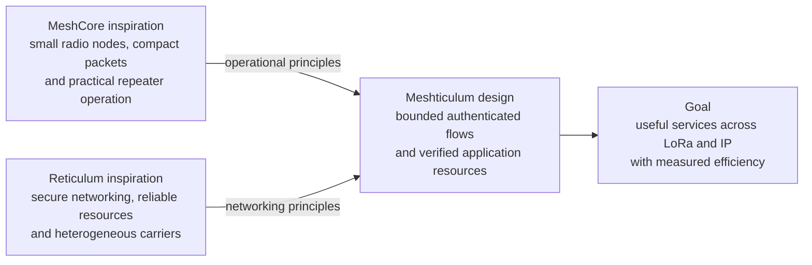

# Why Meshticulum exists

Meshticulum is being built to make small radio networks useful for both private conversations and verified resources, then connect those services across LoRa and IP. We want the practical deployment discipline of an embedded radio mesh and the application capabilities of a secure networking stack, with more of the scarce radio capacity reaching the application as useful data.

MeshCore and Reticulum show two valuable parts of that direction. MeshCore provides a lightweight embedded packet-radio framework and a practical ecosystem of companion nodes, repeaters and room servers. Reticulum provides cryptographic destinations, secure links and reliable resource transfers over heterogeneous carriers. Both already support encrypted communication; Reticulum already connects different media. Our motivation is to explore a particular combination of service boundaries, resource verification and radio scheduling, rather than claim those capabilities are missing from the upstream projects. See the [MeshCore project](https://github.com/meshcore-dev/MeshCore), [Reticulum overview](https://reticulum.network/manual/whatis.html) and [detailed comparison](COMPARISON.md).

[Editable Mermaid](diagrams/why-1.mmd) · [Rendered SVG](diagrams/why-1.svg)

The arrows describe design influences. Meshticulum has its own experimental wire protocol; they do not indicate that an unmodified MeshCore or Reticulum peer can join a Meshticulum network.

## The gap we want to bridge

A radio network should be able to carry a private note, a signed public reference pack, or a missing piece of an interrupted download. When a local IP route is available, the same resource should be able to use it. When that route disappears, the receiver should keep the pieces it has already verified and obtain fresh permission for the slower path.

That requires several things to work together:

- **Application trust that survives a relay.** Private messages retain recipient encryption and sender signatures. Public resources retain their publisher signature and content hashes. A gateway forwarding bytes does not become their author.
- **Reliable transfers that fit a small radio.** Receiver credit limits outstanding data. Selective acknowledgements avoid retransmitting everything after one lost frame. Bounded queues, retries and bursts keep transfer behavior finite.
- **A complete cost for scarce media.** Requests, responses, acknowledgements and retries all consume capacity. The radio owner keeps attempt and airtime debt even when an application cancels or a process restarts.
- **Path choice based on useful work.** Only verified resource bytes train the local path estimator. Shared bottlenecks and elapsed request time matter; a route name or advertised rate does not prove which path finishes sooner.

These are implemented source boundaries in the [flow](../src/meshticulum/flow/flow.py), [authenticated carrier](../src/meshticulum/bench/wire.py), [resource verifier](../src/meshticulum/resources/lamplighter.py), [path scheduler](../src/meshticulum/resources/swarm.py) and [service runner](../src/meshticulum/bench/service_runner.py). The complete mixed LoRa/IP deployment is still being qualified; the [roadmap](ROADMAP.md) records the remaining integration work.

## Why performance matters

Higher useful throughput changes what a radio network can reasonably deliver. Reducing overhead and unnecessary retransmissions can reduce shared-medium cost; retaining verified pieces avoids transferring them again. Faster delivery alone does not establish lower RF airtime, which remains unmeasured in the retained results.

Meshticulum pursues that efficiency through compact binary envelopes, bounded block transfers, receiver credit, burst scheduling and acknowledgement coalescing. The public MR1 adapter moves raw blocks over the scarce carrier and reconstructs host-side batch envelopes locally, avoiding HTTP and base64 expansion on the radio path. The compact private codec preserves the existing encrypted and signed bytes while removing text encoding overhead. See [MR1](../src/meshticulum/resources/resource.py) and the [binary envelope codec](../src/meshticulum/privacy/mesh_binary_envelope.py).

Those mechanisms provide a reason to test for a faster useful network. They do not establish that Meshticulum outperforms either upstream stack. [Performance evidence](PERFORMANCE.md) distinguishes retained radio observations, the throughput target and the matched MeshCore/Reticulum comparison still to be run. We count useful application bytes against the recorded transfer interval, require receiver verification separately, and keep loss, retries, completion and latency visible alongside goodput.

## What success looks like

The programme must demonstrate a coordinated LoRa-to-IP transfer, IP failure followed by fresh LoRa admission and verified-piece resume, then a return to the locally measured faster IP path. It must preserve the original peer bindings, deadlines, replay decisions and ownership boundaries throughout.

A faster transfer only counts when it delivers the intended verified object under those constraints. Source tests support development; current hardware and application evidence establish deployment readiness. The architecture and comparison documents explain the design, while the [hardware guide](HARDWARE.md), [performance record](PERFORMANCE.md) and [roadmap](ROADMAP.md) track that qualification.
